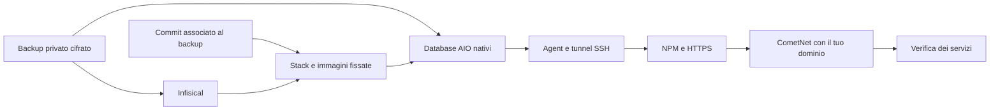

# Streams AIO Recovery

### Il tuo stack, pronto a ripartire.

Una GUI Windows per recuperare Infisical, configurazioni AIO, NPM e servizi su due VM Ubuntu.

**0.4.0 preview · [Guida pratica](docs/USAGE.md) · [VM in Proxmox](docs/PROXMOX.md) · [Versioni precedenti](docs/RELEASE-NOTES.md)**

## Due pulsanti, un percorso

| **Crea da zero** | **Rileva e continua** |
| --- | --- |
| Parti da due VM vuote con SSH disponibile. Il programma installa Docker e ricostruisce lo stack dal backup completo. | Il programma controlla entrambe le VM, riconosce il recupero scelto e riprende i passi compatibili senza azzerare i dati. |

Configura gli accessi una volta nella sessione, carica un backup e torna alla **Panoramica**. Le schede mostrano Infisical, Stack, AIO, Agent, Domini e Servizi; gli errori indicano il passaggio da correggere. **Salva esiti** esporta il registro dei controlli.

**Stato della preview:** il nuovo flusso è implementato e sottoposto a test locali. Il recupero completo della 0.4.0 da VM vuote, i login AIO e il collegamento CometNet pubblico devono ancora essere collaudati sulle VM. Questa versione non certifica ancora una copia operativa identica alla produzione. [Cosa manca alla verifica finale](docs/USAGE.md#collaudo-finale).

## Cosa recupera

| Componente | Comportamento del nuovo percorso |
| --- | --- |
| **Infisical** | Recupera configurazione privata, chiavi applicative, ruoli e database; verifica l’API. |
| **Stack** | Usa il commit registrato nel backup, ricostruisce configurazioni e permessi e controlla le immagini fissate per digest. |
| **AIOStreams e AIOMetadata** | Ripristina gli snapshot nativi SQLite con profili, identità, hash delle password e dati OAuth presenti nel backup. Verifica immagini e chiavi di cifratura associate. |
| **Agent** | Installa l’Agent continuo e il tunnel SSH permanente verso Infisical. |
| **NPM e domini** | Recupera NPM, riemette TLS secondo la configurazione prevista e controlla HTTPS sulla destinazione recuperata. |
| **CometNet** | Usa l’indirizzo WSS e i parametri reali da Infisical; NPM e HTTPS vengono preparati prima del suo controllo di raggiungibilità. |
| **Controller pubblici** | Cloudflare DDNS, Watchtower e Deunhealth vengono attivati per ultimi nel recupero della produzione; restano esclusi nella prova affiancata. |

Comet, CometNet, StremThru e le cache già dichiarate ricostruibili ripartono vuoti: credenziali e configurazioni vengono recuperate, mentre scraping, indici e cache si ricostruiscono. Lo snapshot AIO non comprende l’intero PostgreSQL o tutti i volumi Docker. Gli stati opzionali di altri servizi, come registrazioni di nodi o account locali, devono essere verificati nell’inventario finale. [Dati conservati e dati ricostruibili](docs/USAGE.md#dati-conservati-e-dati-ricostruibili).

## Cosa serve

| Input | Cosa preparare |
| --- | --- |
| **Due VM** | Ubuntu Server **26.04 o 24.04 amd64**, OpenSSH, sudo e utente UID/GID 1000. Possono avere nomi utente diversi. Docker viene installato dalla GUI. |
| **Accessi SSH** | IP, utente e password Ubuntu, oppure chiave SSH, per ciascuna VM. Sudo e passphrase si compilano nelle opzioni solo quando necessari. |
| **Token GitHub** | Fine-grained con **Contents: Read** su `dav1dera/streams-aio-dr` e `dav1dera/streams-aio-sanitized`. |
| **Identity age privata** | File PRIMARY o RECOVERY compatibile con il backup, contenente `AGE-SECRET-KEY-1…`. Una chiave pubblica `age1…` non decifra. |
| **Backup completo** | Release privata con manifest **schema 2** e `aio-state.tar.gz.age`. Il commit coerente viene caricato dal manifest. |
| **Instradamento dei domini** | DNS e router devono già portare il traffico alla destinazione prevista per la modalità scelta. |

Schermata reale: Accessi e backup

Il percorso normale non richiede export JSON AIO, companion o client secret Infisical da inserire a mano. Le credenziali dell’Agent vengono recuperate dal backup. I vecchi backup senza snapshot AIO possono essere riconosciuti, ma non soddisfano il nuovo recupero automatico completo.

La GUI lavora su VM già create: installazione di Ubuntu, creazione delle VM in Proxmox e instradamento del router restano preparativi esterni. Non modifica automaticamente DNS o port forwarding. Immagini e layout non compatibili vengono segnalati, anziché essere adattati senza verifica.

## Prova affiancata o recupero della produzione?

| | **Prova affiancata alle VM operative** | **Recupero della produzione** |
| --- | --- | --- |
| VM originali | Rimangono operative. | Il traffico deve essere destinato alle VM sostitutive. |
| Domini | Stessi nomi del backup, con instradamento DNS dedicato al test. | Stessi nomi del backup, instradati alla destinazione di produzione. |
| NPM / HTTPS / CometNet | Controllati sulla nuova destinazione; CometNet usa il dominio reale. | Controllati sulla nuova destinazione prima dell’attivazione finale. |
| DDNS / Watchtower / Deunhealth | Esclusi per evitare azioni concorrenti alla produzione. | Attivati per ultimi dopo la verifica dei domini. |

L’instradamento della prova deve funzionare anche dal contenitore Comet, attraverso Gluetun/VPN: modificare soltanto il file hosts di Windows non basta. Il programma prova la destinazione con una risposta temporanea univoca di NPM, così il certificato del server originale non può far passare per riuscito il recupero. Il traffico P2P da Internet richiede una prova esterna distinta.

## Primo utilizzo

1. Prepara le VM e apri **Accessi e backup**.
2. Inserisci i due accessi SSH e il token; premi **Carica backup** e scegli un punto completo. Il relativo commit viene compilato automaticamente.
3. Scegli il file della identity age privata, la destinazione del recupero e l’**Indirizzo IP previsto per i domini**.
4. Torna a **Panoramica** e premi **Crea da zero**. Per un tentativo già avviato usa **Rileva e continua** con gli stessi backup e destinazioni.
5. Al termine esegui i login e le prove applicative della [guida pratica](docs/USAGE.md). Conserva gli esiti insieme al punto di recupero.

**Crea da zero non è un pulsante di cancellazione.** Una VM con risorse estranee o un checkpoint incompatibile viene fermata prima del ripristino. Per simulare di nuovo un disastro completo, ripristina uno snapshot pulito delle sole VM di test o creane due nuove.

## Backup giornaliero

Il timer giornaliero è stato **installato e verificato sull’host originale il 9 ottobre 2026**: esecuzione alle **04:30 nel fuso della VM**, ritardo casuale fino a 10 minuti e recupero delle esecuzioni perse. Il timer è attivo e abilitato; al controllo la prossima esecuzione risultava il **10 ottobre alle 04:35:05 CEST**. La politica conserva **cinque release verificate**, quindi normalmente cinque punti giornalieri; esecuzioni manuali aggiuntive consumano lo stesso numero di punti.

La modifica della frequenza ha conservato lo stato applicativo verificato dell’originale. **La pubblicazione e la decifratura di un nuovo backup completo con AIO e collegamenti NPM restano da confermare.** Le vecchie release non acquisiscono questi dati aggiornando il timer. [Verifiche del backup](docs/USAGE.md#backup-giornaliero).

## Cosa è stato verificato

| Evidenza | Stato |
| --- | --- |
| Nuova dashboard, selezione del backup coerente, snapshot AIO e profilo operativo | Implementati; test locali. |
| Ripresa, controlli di proprietà, ordine NPM → CometNet e prova della destinazione | Test locali; collaudo integrato sulle VM pendente. |
| Prova precedente 0.3.17 | Avvio dei 28 servizi previsto dalla simulazione riuscito il 9 ottobre; AIO manuale, CometNet locale, tre controller esclusi. |
| Nuova esecuzione 0.4.0 da VM vuote | **Da eseguire.** |
| Login, profili AIO, OAuth, P2P pubblico e ripartenza dopo riavvio | **Da eseguire.** |
| Timer giornaliero applicato sull’originale | **Verificato il 9 ottobre 2026**: attivo, abilitato, calendario giornaliero; stato applicativo conservato. |
| Nuovo backup completo AIO e collegamenti NPM | **Pubblicazione e decifratura da confermare.** |

Il successo della prova 0.3.17 rimane un riferimento storico; non certifica il nuovo recupero con domini pubblici e AIO automatico.

## Codice e build

Il programma usa Python/Tk e SSH. L’eseguibile include gli strumenti remoti, senza chiavi, token o backup reali. Per compilarlo usa `build.ps1`; per i test Python usa `python -B -m unittest discover -s tests`. Alcuni controlli richiedono Linux/Docker; i test saltati non sono verifiche dal vivo. I test del helper NPM sono in `tests/check_domain_probe.mjs`.

Le versioni delle applicazioni devono corrispondere al backup e al profilo di compatibilità verificato. Un nuovo commit dello stack non implica supporto automatico per qualsiasi nuova immagine Docker.
