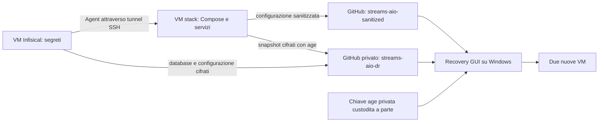

# Streams AIO Recovery

**Guida in italiano per organizzare lo stack, conservarne i backup e recuperarlo su due VM.**

**Sviluppo 0.5.0-dev.8:** nuova interfaccia desktop scura ispirata ad AIOStreams,
con accessi affiancati, procedura per i servizi in quattro passi ed esiti sempre
visibili. La finestra usa Edge WebView2 e carica soltanto risorse incluse nel
programma, senza CDN o font da scaricare. I controlli restano nel backend Python.
La scheda **Aggiungi servizio** comprende analisi offline,
separazione pubblico/privato e procedura per Agent, avvio, pubblicazione e backup verificato.
È un’anteprima in collaudo, separata dalla versione stabile 0.4.19. Non è stata ancora
provata sulle VM reali e non supporta l’aggiunta di nuovi volumi o database persistenti.
Il riquadro di laboratorio prepara due VM vuote senza avviare lo stack completo;
il collaudo locale esclude esplicitamente pubblicazione GitHub e backup.
Leggi [uso e limiti dell’anteprima](docs/AGGIUNGI-SERVIZIO.md) prima di applicare modifiche.

**Versione 0.4.19** · [Scarica programma e checksum](https://github.com/dav1dera/streams-aio-recovery-gui/releases/tag/v0.4.19) · [Setup iniziale](docs/SETUP-DA-ZERO.md) · [Uso della GUI](docs/USAGE.md) · [Note della versione](docs/RELEASE-NOTES-v0.4.19.md)

La GUI Windows recupera **Infisical su una VM separata** e **Streams AIO sull'altra** partendo da un backup completo. Ripristina configurazioni, segreti, database AIO e NPM; prepara Agent, tunnel SSH, servizi e HTTPS.

**«Un clic» significa avviare il recupero dopo aver preparato VM, accessi, backup e instradamento.** La GUI installa Docker, ma non crea le VM, non installa Ubuntu e non configura AdGuard o il router. Non serve installare Python sul PC Windows.

## Da dove cominciare

- **Hai già il sistema e un backup completo?** Vai a [recuperare con la GUI](#recuperare-con-la-gui).
- **Vuoi costruire un sistema simile da zero?** Leggi [il setup iniziale](docs/SETUP-DA-ZERO.md): creare il primo sistema e recuperare un sistema già salvato sono due percorsi diversi.
- **Vuoi aggiungere un container?** Usa il [template completo in sei passaggi](#aggiungere-un-container-sei-passaggi).
- **Vuoi capire cosa succede alle modifiche quotidiane?** Leggi [aggiornamenti e backup](#aggiornamenti-e-backup).

## Come è organizzato il sistema



| Componente | A cosa serve |
| --- | --- |
| **VM stack** | Esegue Compose, applicazioni, Nginx Proxy Manager, Agent Infisical e coordinatore dei backup. |
| **VM Infisical** | Conserva i segreti; ha il proprio backend, PostgreSQL e Redis. |
| [streams-aio-sanitized](https://github.com/dav1dera/streams-aio-sanitized) | Conserva Compose, impostazioni pubbliche, template e riferimenti alle immagini. |
| **streams-aio-dr**, repository privato | Conserva strumenti DR e release con i backup cifrati, accessibili agli account autorizzati. |
| **Questo repository** | Contiene codice, guida ed eseguibile della Recovery GUI. |

**Per chi usa repository propri:** la versione attuale è adattata al deployment di riferimento. La GUI usa `dav1dera/streams-aio-sanitized` e `dav1dera/streams-aio-dr`; non offre un selettore per repository arbitrari. Per replicarla con un altro account occorre adattare riferimenti, percorsi, associazioni dei secret e profilo di recupero, poi creare e collaudare i propri backup. Clonare il repository pubblico non crea i segreti o il primo backup privato.

## Cosa tenere pubblico e cosa mettere in Infisical

| Dato | Dove si modifica |
| --- | --- |
| IP interni, subnet Docker, porte, nomi dei servizi | Compose e normali file di configurazione dello stack. |
| Worker, TTL, opzioni e URL senza credenziali | `.env` pubblico del servizio o file YAML/JSON/TOML ordinario. |
| Password, token, chiavi API e chiavi di cifratura applicative | Infisical. |
| URL di database contenenti password o token | Infisical, come gli altri valori privati. |

L'Agent legge i secret e genera i file privati previsti, per esempio `.secrets/comet.env`. **Non serve nascondere in Infisical ogni parametro ordinario.** I file pubblici restano modificabili sulla VM; i file privati generati vanno modificati attraverso la loro sorgente in Infisical.

La separazione usa percorsi ammessi, template, associazioni esplicite e controlli dei contenuti. Non riconosce infallibilmente un segreto dal nome della variabile. **Non incollare password in un file dichiarato pubblico.** Un file escluso dalla pubblicazione pubblica non viene automaticamente incluso nel backup cifrato.

## Aggiornamenti e backup

Nel deployment di riferimento sono attivi processi diversi:

| Processo | Frequenza configurata | Cosa fa |
| --- | --- | --- |
| **Sincronizzazione pubblica** | Circa ogni 15 minuti | Controlla le modifiche locali ammesse e pubblica un commit solo se necessario. |
| **Backup DR cifrato** | Ogni giorno alle 04:30 Europe/Rome, con ritardo fino a 10 minuti | Sincronizza prima la parte pubblica e pubblica un nuovo punto completo; conserva gli ultimi cinque punti verificati. |
| **Aggiornamenti dei container con WUD** | Ogni giorno alle 05:00 Europe/Rome | Aggiorna il digest del tag scelto, esclude Gluetun, rimuove le vecchie immagini dopo gli aggiornamenti riusciti e include il proprio aggiornamento. |
| **Agent Infisical** | Secondo il suo polling | Aggiorna i file privati previsti dai mapping. Non sostituisce il backup DR. |

La direzione della sincronizzazione è **VM locale → GitHub**. Modificare GitHub non distribuisce automaticamente una configurazione ai container. Anche modificare un `.env` o un secret può richiedere di ricreare il servizio interessato per applicarlo al processo già avviato.

Per il percorso standard basta modificare **Compose e gli env pubblici sulla VM**, inserire i secret nella **GUI Infisical** e mantenere un **template Agent esplicito** per il file privato del servizio. Il worker aggiornato pubblica le modifiche ammesse; il backup cifrato conserva valori e configurazione Agent. La GUI **0.4.19** può ricreare anche un nuovo `.secrets/servizio.env` prima dei controlli Compose, senza aggiungere a mano il suo mapping su GitHub. Segui i sei passaggi sotto e verifica il successivo backup riuscito.

In **Honey**, il worker pubblico aggiornato conserva le associazioni private sulla scheda riconosciuta tramite riferimenti pubblici univoci, anziché spostarle con l'indice della riga. Inserire o riordinare schede riconoscibili mantiene le associazioni; riferimenti ambigui o la rimozione di una scheda con binding fermano la sincronizzazione con `HONEY_BOUND_LAYOUT_REVIEW_REQUIRED`. Conserva le identità riconoscibili e controlla la modifica. Questa correzione richiede il worker aggiornato sulla VM; aggiornare la sola GUI non aggiorna quel processo.

Ogni backup è una **fotografia del momento della cattura**. Una modifica a Infisical, AIOStreams o AIOMetadata entra nel successivo backup riuscito; le release già pubblicate non si aggiornano. Il timer attivo non prova da solo che l'ultima esecuzione sia riuscita.

Sulla VM stack puoi controllare o anticipare i processi:

```bash
# Prossime esecuzioni.
systemctl list-timers streams-aio-public-sync.timer streams-aio-dr.timer --no-pager --full

# Esito dell'ultima esecuzione, senza mostrare i secret.
systemctl show streams-aio-public-sync.service streams-aio-dr.service \
  -p Id -p Result -p ExecMainStatus -p ExecMainExitTimestamp

# Pubblica subito le modifiche pubbliche ammesse.
sudo systemctl start streams-aio-public-sync.service

# Crea subito un nuovo punto DR cifrato.
sudo systemctl start streams-aio-dr.service
```

Un servizio a esecuzione singola può risultare `inactive` dopo aver finito: controlla `Result=success`, `ExecMainStatus=0`, timer attivo e data della nuova release. Le unità attuali non inviano notifiche automatiche di errore.

**Aggiungere un servizio non aggiunge automaticamente il backup del suo database.** Prepara variabili pubbliche, mapping Agent per i secret, directory/permessi, dipendenze e inizializzazione. Decidi se i suoi dati possono ripartire vuoti o richiedono backup e ripristino dedicati. [Esempi pratici](https://github.com/dav1dera/streams-aio-sanitized/blob/main/docs/ESEMPI-PRATICI.md).

## Aggiungere un container: sei passaggi

Per lo stack `/home/pi/streams-aio`, progetto Infisical **streams-aio**, ambiente **Production (`prod`)**. Sostituisci `nuovo-servizio`, immagine, porte, percorso dati e `API_TOKEN` con quelli dell'applicazione. L'esempio non richiede un database separato: se serve, prepara anche utenti, schema e inizializzazione.

### 1. Cartelle, impostazioni pubbliche e Infisical

```bash
cd /home/pi/streams-aio
mkdir -p data/nuovo-servizio/data
```

Crea `data/nuovo-servizio/.env` con sole impostazioni pubbliche, ad esempio `LOG_LEVEL=info`. Assegna alla directory dati UID/GID richiesti dall'immagine. In Infisical apri **streams-aio → Production**, crea `/nuovo-servizio` e il secret `API_TOKEN`; verifica che l'identità dell'Agent possa leggerlo. Password, token e URL con credenziali restano qui; IP e porte ordinari restano nello stack.

### 2. Agent: mapping e verifica

Nel file **esistente** `/etc/infisical/agent-config.yaml` aggiungi sotto `templates:` questa voce, conservando autenticazione, proprietari e template precedenti:

```yaml
  - template-content: |
      API_TOKEN={{ with getSecretByName "f80601b1-73fb-49bd-9373-f3687cd5c8eb" "prod" "/nuovo-servizio" "API_TOKEN" }}{{ .Value | replace "$" "$$" | printf "%q" }}{{ end }}
    destination-path: /home/pi/streams-aio/.secrets/nuovo-servizio.env
    config:
      polling-interval: 60s
```

Ripeti la riga per ogni secret. `replace` protegge i dollari dall'interpolazione Compose; `%q` quota il valore. Il progetto è identificato dall'ID. Prima di riusare il pattern con credenziali particolari verifica l'equivalenza **Infisical → Agent → Compose → renderer DR**, con valori fittizi contenenti `$`, virgolette, apostrofi e backslash: confronta in memoria e stampa solo PASS/FAIL. I secret multilinea richiedono una prova specifica. Non aggiungere `format: raw` senza rendere compatibile anche il DR.

```bash
sudo systemctl restart infisical-agent.service
systemctl is-active infisical-agent.service
test -s .secrets/nuovo-servizio.env
stat -c '%a %U:%G' .secrets/nuovo-servizio.env
```

Attendi la generazione. Il file deve essere privato e leggibile dall'utente Compose: sull'originale può essere **640 root:pi**; dopo il recupero **600 dell'utente di deployment**. Non usare 644 e non stampare il contenuto.

### 3. Compose e label WUD

Inserisci sotto `services:`, adattando reti, healthcheck e dipendenze:

```yaml
  nuovo-servizio:
    image: REGISTRY/IMMAGINE:TAG_VERIFICATO
    container_name: nuovo-servizio
    restart: unless-stopped
    profiles: [all]
    env_file:
      - ./data/nuovo-servizio/.env
      - ./.secrets/nuovo-servizio.env
    volumes:
      - ./data/nuovo-servizio/data:/PERCORSO_DATI
    ports:
      - "127.0.0.1:PORTA_HOST:PORTA_CONTAINER"
    labels:
      wud.tag.include: '^$${raw}$$'
      wud.watch.digest: 'true'
```

Il binding localhost è un esempio: per NPM usa una rete Docker comune o un collegamento adeguato. Per un dominio nuovo configura anche proxy e DNS. Senza secret ometti secondo env file e mapping. Non duplicare variabili private in `environment:`, che prevale sugli env file.

Le label mantengono il tag corrente e controllano il digest; diventano effettive **ricreando il container**. Per escluderlo aggiungi `wud.watch: 'false'`. Gluetun è escluso anche con `EXCLUDE=^gluetun$`. Nel riferimento WUD aggiorna automaticamente alle **05:00 Europe/Rome**: escludi i servizi che vuoi aggiornare personalmente.

### 4. Contratto DR: il template Agent resta la sorgente privata

Per questo percorso **non occorre modificare a mano `env_files` o `required_values` su GitHub**. Il worker inventaria il servizio, pubblica l'env pubblico ammesso e registra che il file privato deve essere generato dall'Agent. Il template del passo 2, conservato nel backup cifrato dell'Agent, indica esplicitamente cosa leggere e dove scriverlo: il nome del file non viene usato per indovinare la cartella Infisical.

Durante il recupero, la GUI **0.4.19** usa quel template per generare il nuovo env privato prima del primo controllo Compose. Dopo la preparazione installa l'Agent continuo, che mantiene i successivi aggiornamenti dei secret. Verifica che la destinazione del template e il percorso `env_file` di Compose coincidano esattamente.

Il percorso supportato usa servizi dichiarati direttamente in `docker-compose.yml`, impostazioni pubbliche in `data/servizio/.env` ed env privati obbligatori `.secrets/*.env`. Gli `env_file` del servizio non alimentano l'interpolazione `${VAR}` o `$VAR` del Compose: una nuova variabile obbligatoria non prevista dai binding del `.env` principale viene rifiutata. Le normali impostazioni pubbliche negli env del servizio restano supportate e i binding già previsti per il file principale vengono conservati. I Compose con `include` o `extends` e i file misti YAML/JSON richiedono una verifica dedicata. Un updater richiede anche la policy GUI: escluso nella prova affiancata, avviato per ultimo in produzione.

**I dati non sono inclusi automaticamente:** la directory viene ricreata vuota. Per WUD è il mount `/store`; dati indispensabili richiedono backup e ripristino dedicati.

### 5. Valida, avvia e prova il singolo servizio

```bash
cd /home/pi/streams-aio
test -s .secrets/nuovo-servizio.env
docker compose --profile all config --quiet
docker compose --profile all pull nuovo-servizio
docker compose --profile all up -d --no-deps nuovo-servizio
docker compose --profile all ps nuovo-servizio
docker inspect --format '{{ index .Config.Labels "wud.tag.include" }} | {{ index .Config.Labels "wud.watch.digest" }} | {{ index .Config.Labels "wud.watch" }}' nuovo-servizio
```

Ometti `test -s` solo senza secret. Prosegui soltanto se ogni comando riesce. Le dipendenze devono già essere disponibili; controlla eventuali override Compose attivi. Prova login/API e funzione reale, non solo lo stato del container.

### 6. Sincronizza e verifica un nuovo backup

I timer sincronizzano automaticamente le modifiche pubbliche ammesse e creano il successivo punto DR. L'unità verificata `streams-aio-public-sync.service` usa il worker separato e **`--seamless --publish`**; il backup DR esegue prima la sincronizzazione pubblica. I comandi sotto servono ad anticipare il controllo e il backup, senza attendere gli orari configurati.

Per controllare subito senza pubblicare:

```bash
SYNC_HOME=/home/pi/.local/share/streams-aio-public-sync
"$SYNC_HOME/venv/bin/python" -B "$SYNC_HOME/tooling/scripts/sync-public-stack.py" \
  --source /home/pi/streams-aio --seamless
```

Se vuoi anticipare il salvataggio, dopo `PUBLIC_SYNC_CHECK PASS` pubblica e, terminata la sincronizzazione, crea il backup come utente `pi`:

```bash
"$SYNC_HOME/venv/bin/python" -B "$SYNC_HOME/tooling/scripts/sync-public-stack.py" \
  --source /home/pi/streams-aio --seamless --publish
/home/pi/streams-aio-dr/scripts/update-dr.sh
```

Su GitHub controlla nuovo commit, servizio, env pubblico e immagini fissate; i valori `.secrets`, le credenziali e il template Agent privato devono essere assenti. Verifica poi una **nuova release completa schema 2**: sei `.age`, manifest e checksum, associata al commit corretto e catturata dopo aver salvato template Agent e secret Infisical. Richiedi `DR_UPDATE PASS` e pubblicazione verificata. Un timer attivo o un commit pubblico, da soli, non attestano il salvataggio privato. Evita esecuzioni contemporanee.

Il servizio è **operativo** dopo la prova d'uso; le modifiche sono **salvate nel DR** dopo la nuova release verificata. I backup precedenti non acquisiscono retroattivamente template e secret nuovi. Un recupero su VM di test conferma anche il ripristino del nuovo servizio.

## Cosa contiene un backup completo

Il recupero automatico usa una release **schema 2**, composta da otto file:

| File | Contenuto |
| --- | --- |
| `aio-state.tar.gz.age` | Snapshot SQLite nativi AIOStreams/AIOMetadata, identità, profili, configurazioni e metadati necessari al recupero. |
| `npm-database.sqlite.age` | Database NPM con utenti, access list e proxy. |
| `infisical-agent-infisical-agent.tar.gz.age` | Configurazione e credenziali di bootstrap dell'Agent. |
| `infisical-config.tar.gz.age` | Configurazione privata del server Infisical. |
| `infisical-postgres.dump.age` | Database Infisical, inclusi i secret catturati. |
| `infisical-postgres-globals.sql.age` | Ruoli PostgreSQL di Infisical. |
| `manifest.json` | Inventario, checksum e commit associati al punto. |
| `SHA256SUMS` | Checksum del manifest e degli artifact cifrati. |

Compose e configurazioni pubbliche vengono letti dal **commit esatto indicato nel manifest**. Il backup lega database AIO, immagini e chiavi compatibili: non sostituirli con versioni o secret di un altro punto.

**Non occorrono export JSON AIOStreams/AIOMetadata né payload aggiuntivi** nel percorso normale. I relativi selettori sono stati rimossi. L'eventuale file integrativo nelle Opzioni avanzate riguarda soltanto casi precedenti che lo richiedono esplicitamente.

Non è un'immagine completa delle VM: database/cache dichiarati ricostruibili, come quelli di Comet, CometNet, StremThru e Redis, ripartono vuoti. Gli snapshot AIO non includono tutti i volumi Docker o tutto PostgreSQL applicativo; le catture dei componenti non sono un'unica transazione simultanea. Un backup VM/PBS resta una protezione complementare.

## Recuperare con la GUI

### 1. Scarica la versione 0.4.19

Dalla [release](https://github.com/dav1dera/streams-aio-recovery-gui/releases/tag/v0.4.19) scarica `StreamsAIO-Recovery.exe` e `SHA256SUMS`. Sono inclusi anche i sorgenti. Confronta l'hash prima di avviare:

```powershell
Get-FileHash .\StreamsAIO-Recovery.exe -Algorithm SHA256
Get-Content .\SHA256SUMS
```

Usa il checksum della stessa release. L'eseguibile non è firmato con Authenticode. Le credenziali inserite nella GUI restano nella memoria della sessione: dopo averla chiusa devi reinserirle.

### 2. Prepara due VM raggiungibili

| VM | Sistema e accessi | Risorse di partenza indicative |
| --- | --- | --- |
| **Stack** | Ubuntu Server 24.04 o 26.04 amd64, OpenSSH, utente sudo UID/GID 1000 | 4 core, 8 GiB RAM, 80 GiB disco |
| **Infisical** | Stessi requisiti; indirizzo distinto | 2 core, 4 GiB RAM, 32 GiB disco |

Dimensiona disco e memoria per il tuo carico. Le VM devono avere Internet e spazio per immagini, download e ripristino. Docker viene installato se manca. [Preparazione in Proxmox](docs/PROXMOX.md).

Per **Crea da zero** le destinazioni devono essere vuote di recuperi e dati applicativi precedenti. IP e utenti possono essere diversi dagli originali: inserisci quelli attuali. Se una VM ricreata riusa un IP, verifica la nuova impronta SSH dalla console prima di accettarla. [Procedura SSH](docs/USAGE.md#vm-ricreata-o-indirizzo-ip-diverso).

### 3. Prepara DNS, AdGuard e router

Questo passaggio è **manuale e precedente all'avvio**. La GUI non modifica AdGuard, il resolver di Ubuntu o il router.

1. Nel DNS locale/AdGuard porta i domini recuperati all'**IP LAN della nuova VM stack**, dove si trova NPM. Controlla wildcard e record espliciti: un record Headscale o Infisical può prevalere sul wildcard.
2. Anche il **dominio HTTPS di Infisical** deve raggiungere NPM sulla VM stack: il proxy inoltra alla VM Infisical separata. Non puntarlo direttamente all'IP del database.
3. Sul router inoltra **TCP 80 e 443 alla VM stack**, non a entrambe le VM. Adegua anche le altre porte effettivamente necessarie alle applicazioni.
4. Controlla DNS pubblico, provider ACME/Cloudflare, VPN, NAT loopback e firewall. I domini devono funzionare anche dalle VM/container, incluso Gluetun per CometNet. Un file `hosts` sul solo Windows non basta.

Esempio: con stack `.20` e Infisical `.31`, i domini AIO, Headscale e il dominio HTTPS Infisical raggiungono `.20`; l'API privata Infisical viene collegata alla `.31` dal recupero. Sono esempi, non vincoli.

Se un addon funziona dal telefono ma non dal PC, controlla **DNS del client**, cache, VPN o DNS sicuro: due dispositivi possono raggiungere server diversi. Un container sano non prova che Stremio raggiunga l'addon.

### 4. Compila «Accessi e backup»

| Campo | Cosa inserire |
| --- | --- |
| **VM Stack / VM Infisical** | IP, utente e password SSH oppure file della chiave SSH autorizzata. Sudo/passphrase separati solo se necessari. |
| **Token GitHub** | Fine-grained con **Contents: Read** sui due repository del recupero. Per ripristinare non serve scrittura. |
| **Backup pubblicato** | Premi **Carica backup** e scegli una release completa schema 2. Il commit viene compilato dal manifest. |
| **Chiave age PRIMARY o RECOVERY** | Chiave privata compatibile contenente `AGE-SECRET-KEY-1…`. La versione stabile usa il file; nell’anteprima puoi scegliere **File** oppure **Incolla**. Una chiave pubblica `age1…` non decifra. |

Nell’anteprima, con **File** scegli il file privato già custodito sul PC. Con
**Incolla** inserisci la chiave privata nel campo mascherato: non serve creare un
file Windows. La GUI conserva il testo nella memoria della sessione e lo trasferisce
direttamente via SFTP autenticato a un file privato sulla VM, con permessi `0600`,
per gli stessi controlli di decifratura. Non crea un file temporaneo locale con la
chiave incollata e non la include in esiti, piani esportati o memoria persistente
del browser. Dopo la chiusura dell’app devi reinserirla. Continua a custodirne una
copia protetta fuori dalla sessione: il campo **Incolla** non è un archivio delle chiavi.

Nel riquadro **Domini e controller prima dell'avvio** scegli modalità e **indirizzo IP previsto per i domini**. Il campo descrive l'instradamento predisposto: non lo cambia. Usa l'IP LAN per un percorso LAN effettivo, oppure l'IP pubblico atteso per il percorso pubblico; non copiarci automaticamente l'IP SSH.

| Modalità | Quando usarla |
| --- | --- |
| **Prova affiancata alle VM operative** | Collaudo con instradamento dedicato verso le VM di prova. DDNS, WUD (oppure Watchtower nei backup precedenti) e Deunhealth vengono esclusi. |
| **Recupero della produzione** | Sostituzione delle originali. Attiva i controller pubblici per ultimi; evita istanze originali e recuperate concorrenti. |

La modalità affiancata non crea domini nuovi o isolamento automatico. Se sposti gli stessi DNS e inoltri, sposti il traffico. Per provare la modalità produzione spegni prima le originali.

### 5. Premi «Crea da zero» e attendi

La GUI recupera Infisical, prepara lo stack, importa i database AIO/NPM, installa Agent e tunnel, adatta i collegamenti interni alle nuove VM e verifica avvio, NPM, Headscale/Headplane, Tailscale, HTTPS e CometNet.

Tieni il PC acceso e collegato. Non eseguire un secondo recupero o modifiche parallele sulle VM. Non serve premere più volte il pulsante.

Se un passo si ferma, usa **Salva esiti**, correggi la causa e premi **Rileva e continua**. Il recupero riconosce il proprio backup, commit e stato: il backup più recente non sostituisce quello di un tentativo iniziato. **Crea da zero non cancella un'installazione esistente.** Non eliminare checkpoint per forzare un controllo.

## Dopo il recupero

- Accedi a Infisical, NPM e alle due applicazioni AIO; controlla profili e integrazioni.
- Prova gli addon reali in Stremio e i servizi dall'esterno, se previsti. OAuth, token revocati/scaduti e dispositivi esterni possono richiedere interventi propri.
- NPM può conservare proxy verso altri dispositivi: la GUI non ricrea quei server. Un upstream esterno spento viene segnalato senza cancellarne la configurazione.
- Agent e tunnel sono installati come servizi persistenti. Riavvia entrambe le VM e ripeti le prove per verificare il setup nel tuo ambiente.
- **Dopo una sostituzione definitiva reinstalla e verifica sincronizzazione pubblica e coordinatore dei backup. La GUI non li reinstalla automaticamente.** Segui la [guida del worker pubblico](https://github.com/dav1dera/streams-aio-sanitized#attivare-la-sincronizzazione) e la [guida DR](https://github.com/dav1dera/streams-aio-dr#install-on-docker-stack), quindi verifica una nuova release completa realmente pubblicata.

Per tornare alle originali dopo un collaudo: **spegni le VM di prova**, ripristina DNS rewrite e inoltri router, poi riaccendi le originali. Non lasciare due coordinatori DR o due gruppi di controller pubblici attivi per lo stesso ambiente.

## Cosa salvare fuori dal PC

1. **Entrambi i file age privati PRIMARY e RECOVERY**, in copie protette e separate. Basta uno compatibile per decifrare; perderli entrambi rende inutilizzabili i backup cifrati.
2. Eseguibile, checksum, sorgenti e questa guida.
3. Copia completa degli otto file di un backup verificato e riferimento al suo commit pubblico.
4. Accesso GitHub e recupero MFA, accessi a DNS/router/provider e inventario dei percorsi necessari.

Le chiavi age sono portabili: cambiare PC Windows non richiede rifare il backup. Un token GitHub può essere ricreato. **Non caricare il kit con chiavi private in alcun repository.**

La GUI scarica i backup da GitHub: non offre un import completamente offline. La copia cifrata locale è una riserva per il recupero tecnico; il kit non contiene tutte le immagini Docker e i pacchetti necessari senza Internet.

## Stato delle verifiche

La **0.4.19** aggiunge la generazione iniziale dei nuovi env privati dai template Agent espliciti nel backup, prima dei controlli Compose. La ripresa riconosce soltanto file verificati della stessa generazione: riusa un risultato completo o ricrea una generazione parziale verificata, conservando file estranei o modificati. La suite locale su Windows comprende **790 test raccolti: 741 eseguiti con successo e 49 saltati**, senza errori o fallimenti. Include 15 test del nuovo percorso e i controlli dei messaggi italiani. Non attesta un nuovo recupero completo su due VM; [limiti e dettagli della versione](docs/RELEASE-NOTES-v0.4.19.md).

La **0.4.18** aggiunge WUD alla policy del recupero: escluso nella prova affiancata, avviato dopo i controlli pubblici in produzione e riconosciuto nei report diagnostici. Sono passati **66 test mirati**, il self-test dell’eseguibile e il confronto dei 23 moduli remoti inclusi. Questa verifica non aggiunge un nuovo collaudo completo su due VM alla prova della 0.4.17 descritta sotto.

Il **14 ottobre 2026**, la **0.4.17** ha completato il recupero applicativo da due VM di prova pulite di container, volumi, configurazioni, database e checkpoint precedenti, usando `dr-20261013T023710Z`. **Docker e cache delle immagini erano già presenti**: questa prova non equivale a installare nuovamente Ubuntu senza Docker.

Sono passati i controlli Infisical, AIO, Agent/tunnel, Headplane/Headscale, Tailscale, NPM, HTTPS, CometNet, controller e servizi. È rimasto un avviso per un upstream esterno non raggiungibile. L'utente ha confermato AIOStreams e AIOMetadata funzionanti da Stremio sul telefono; sul PC è stata rilevata una differenza di risoluzione DNS.

La suite locale di quella prova comprendeva **769 test, zero errori/fallimenti e 49 controlli POSIX saltati su Windows**; self-test dell'eseguibile e corrispondenza delle risorse incluse verificati. Non sono stati completati in questa prova il riavvio delle due VM recuperate, tutte le integrazioni esterne e il P2P pubblico. [Checklist finale](docs/USAGE.md#collaudo-finale).

## Guide e sviluppo

[Setup iniziale](docs/SETUP-DA-ZERO.md) · [Uso dettagliato](docs/USAGE.md) · [Proxmox](docs/PROXMOX.md) · [Note 0.4.19](docs/RELEASE-NOTES-v0.4.19.md)

Il programma usa Python/Tk e SSH. `build.ps1` crea l'eseguibile Windows; `tests/` contiene i test e la pipeline GitHub verifica codice, compatibilità Ubuntu e build Windows. Le guide degli altri repository descrivono i rispettivi strumenti; per il percorso corrente con snapshot AIO nativi usa questa guida e un backup schema 2, evitando di mescolarlo con importazioni JSON dei formati storici.
