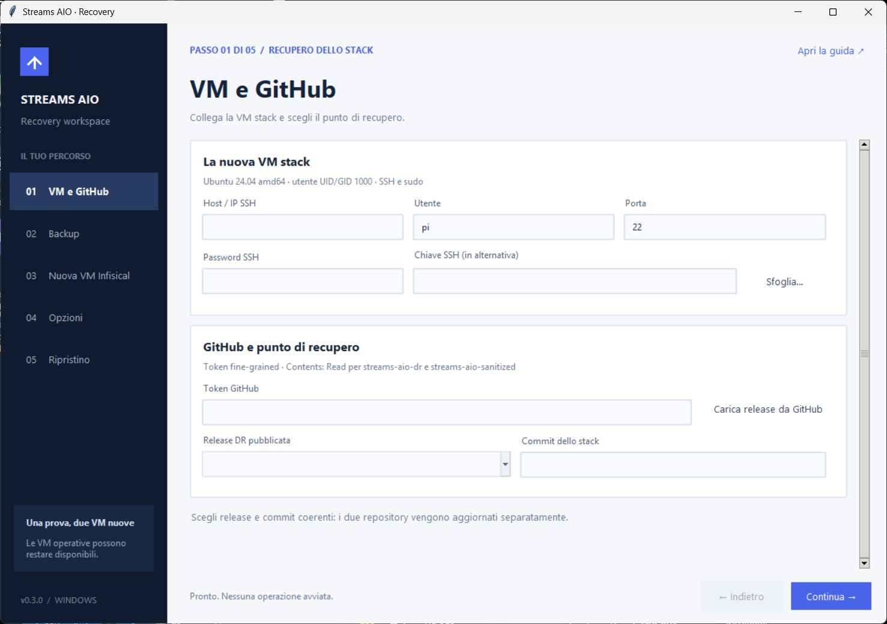
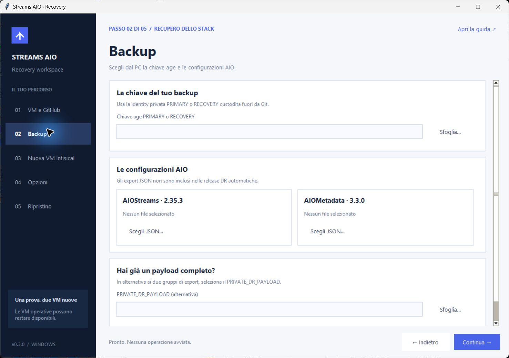
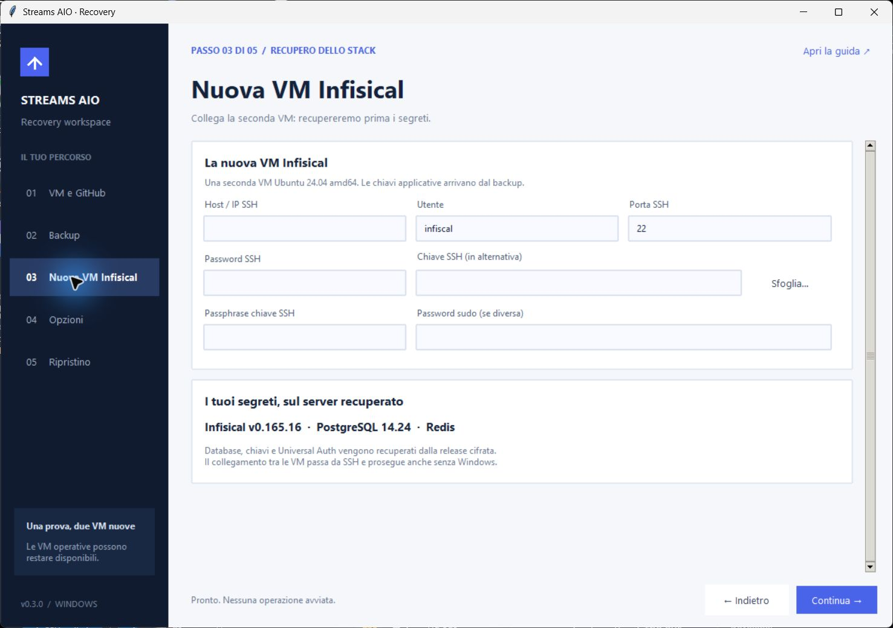
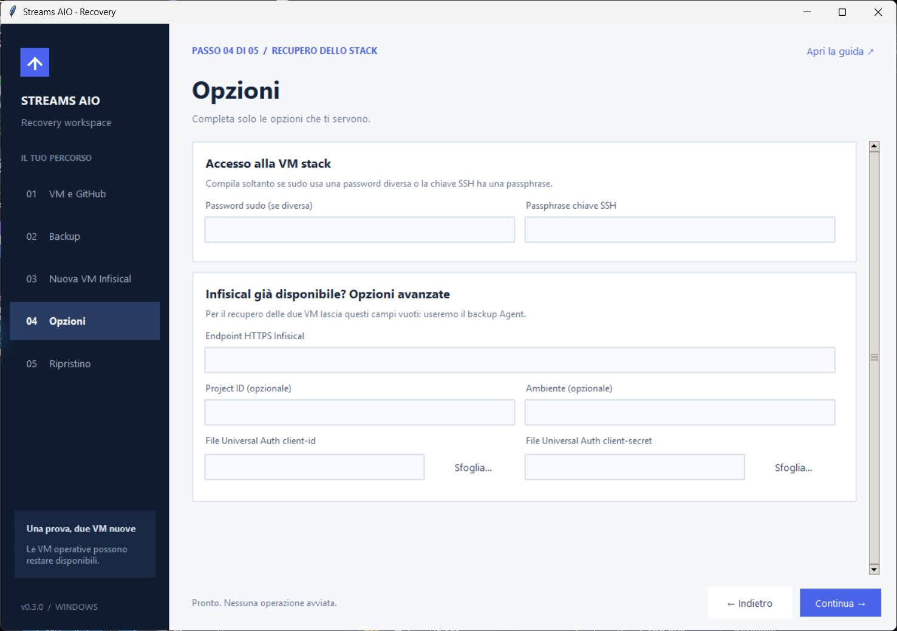
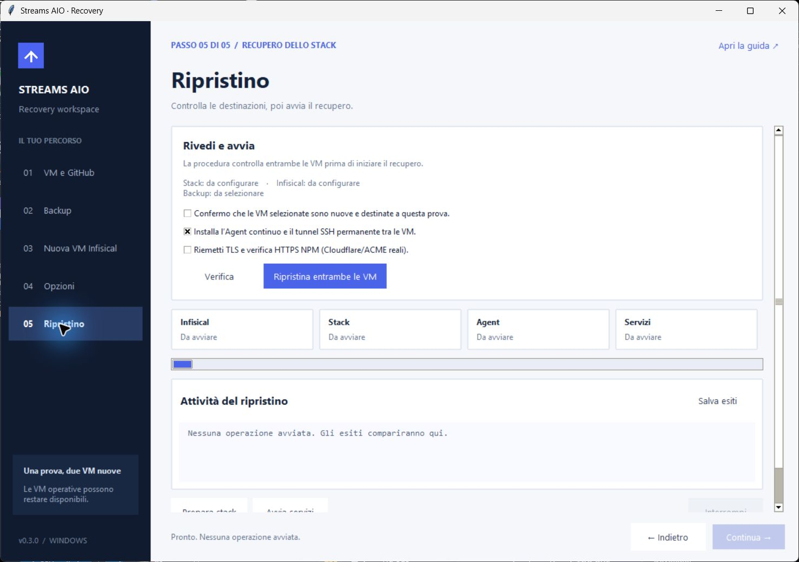
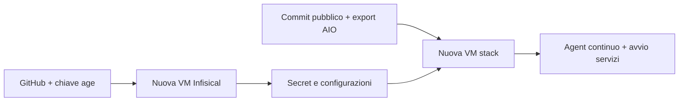

# Streams AIO Recovery

### Il tuo stack, di nuovo operativo. Da Windows a due VM nuove.

SSH, backup cifrati e configurazioni GitHub, in una procedura guidata.

**[Scarica il programma · v0.3.2](https://github.com/dav1dera/streams-aio-recovery-gui/releases/tag/v0.3.2)** · **[Guida completa](docs/USAGE.md)** · **[Backup DR](https://github.com/dav1dera/streams-aio-dr/releases)**

**La v0.3.2 corregge il download DR fermato dai permessi della cartella temporanea.** Se la v0.3.1 si è fermata su `DR_DOWNLOAD_FAILED`, chiudi il vecchio programma e riprova con la v0.3.2 sulle stesse VM, mantenendo release DR e commit dello stack. I checkpoint e i file del tentativo precedente vengono conservati. [Ripresa del download →](docs/USAGE.md#8-se-la-procedura-si-ferma).

**Inserisci gli accessi delle due VM, scegli i backup e premi «Ripristina entrambe le VM».** Il programma installa Docker, recupera Infisical, ricostruisce lo stack e configura l’Agent continuo. Non serve Python sul PC.

Le schermate mostrano il programma reale con i campi vuoti. I test automatici usano dati sintetici; **il collaudo completo con i tuoi backup reali sulle nuove VM resta da eseguire**.

## Prima di aprirlo

| Ti serve | Prepara così |
| --- | --- |
| **Due VM nuove** | Ubuntu Server **26.04 LTS amd64** (anche **24.04 LTS**), SSH attivo, utente UID/GID **1000** e sudo su ciascuna. Per la prova usa IP diversi dalle VM operative. |
| **Accessi SSH** | IP, utente e password oppure file della chiave SSH per entrambe le VM. |
| **Token GitHub di lettura** | Fine-grained token: **Contents: Read** per `streams-aio-dr` e `streams-aio-sanitized`. |
| **Chiave privata age** | Identity PRIMARY o RECOVERY custodita fuori da Git. La chiave pubblica `age1…` non basta. |
| **Configurazioni AIO** | Export JSON di **AIOStreams 2.35.3** e **AIOMetadata 3.3.0**, oppure un `PRIVATE_DR_PAYLOAD` completo. I binding dei profili devono essere presenti in Infisical. |

Gli export AIO vanno conservati separatamente: **le release DR automatiche non li includono**. Docker lo installa il programma. [Preparazione VM, token e verifica del download →](docs/USAGE.md#1-cosa-preparare)

**Hai già caricato `ubuntu-26.04.1-live-server-amd64.iso` su Proxmox? Puoi usare quella.** [Crea le due VM e abilita SSH →](docs/PROXMOX.md). Usa l’eseguibile **v0.3.1 o successivo**: la v0.3.0 accetta soltanto Ubuntu 24.04. Il bootstrap sceglie il repository Docker della versione installata (`resolute` per 26.04, `noble` per 24.04), senza mescolare le distribuzioni. [Requisiti ufficiali Docker](https://docs.docker.com/engine/install/ubuntu/).

Gli screenshot illustrano l’interfaccia v0.3.0; nella v0.3.1 le indicazioni Ubuntu includono anche 26.04.

## Cinque passi, un ripristino

### 01 · Collega lo stack e scegli il backup

Nella schermata **VM e GitHub** mostrata sopra inserisci l’accesso alla nuova VM stack e il token. Premi **Carica release da GitHub**, poi controlla **Release DR pubblicata** e **Commit dello stack**.

Il caricamento propone la release più recente e il commit pubblico corrente. Sono aggiornati separatamente: per recuperare uno stato precedente scegli il commit completo coerente con quella release.

### 02 · Seleziona chiave ed export dal PC

In **Backup**, usa **Sfoglia…** per la chiave privata age e **Scegli JSON…** per i due gruppi di export. Puoi selezionare più profili. Un payload DR completo sostituisce entrambi i gruppi.

### 03 · Collega la seconda VM

In **Nuova VM Infisical**, inserisci l’accesso alla seconda macchina. Le chiavi applicative, il progetto, i secret e Universal Auth arrivano dal backup: non occorre reinserirli a mano.

### 04 · Completa solo le opzioni necessarie

In **Opzioni**, compila la password sudo dello stack se diversa da SSH e l’eventuale passphrase della chiave. Per recuperare **entrambe le VM**, lascia vuoti endpoint, progetto, ambiente e file Universal Auth: il programma usa il backup Agent.

Mostra la schermata delle opzioni

### 05 · Verifica e avvia

Premi **Verifica** e confronta le impronte SSH con quelle delle console delle VM. Controlla le destinazioni, conferma che sono nuove e lascia attivo **Installa l’Agent continuo e il tunnel SSH permanente**. Alla prima prova lascia TLS disattivato.

Premi **Ripristina entrambe le VM** e conferma il riepilogo. Tieni il PC collegato finché la procedura termina. Le quattro schede mostrano lo stato delle fasi; **Salva esiti** conserva un report senza credenziali.

**Interrompi** chiude la connessione e conserva il lavoro parziale; non annulla le scritture già fatte. Se la procedura si ferma, salva gli esiti e consulta la [guida agli errori](docs/USAGE.md#8-se-la-procedura-si-ferma).

## Cosa viene recuperato

| Componente | Risultato |
| --- | --- |
| **Infisical** | Configurazione, chiavi applicative, ruoli e database originali. Redis riparte vuoto. |
| **Stack** | Compose, immagini e configurazioni dal commit pubblico scelto; secret dal nuovo Infisical. |
| **Agent** | CLI **0.43.137**, mapping privati e tunnel SSH permanente tra le VM. Continua anche dopo aver chiuso Windows. |
| **NPM e applicazioni AIO** | Database NPM dalla release cifrata; configurazioni AIO dai file scelti sul PC. TLS è opzionale. |
| **Altri dati runtime** | Ripartono secondo il piano di inizializzazione. Il DR ricostruisce il sistema senza clonare ogni database. |

Il programma rifiuta destinazioni già occupate e mantiene i controlli SSH, SHA256 e di compatibilità. Le credenziali non vengono salvate sul PC; il materiale privato trasferito resta fuori dai clone Git sulle VM.

## Quando ha finito

Prova il login Infisical, la lettura dei secret, NPM, i profili AIO e i servizi che usi. Chiudi la GUI e verifica che Agent e tunnel restino attivi. Un container `healthy` non prova da solo il recupero completo.

I timer di push/backup e Watchtower, DDNS e deunhealth restano disattivati nella prova. Riattivali dopo il collaudo e il passaggio alle nuove VM. L’Agent aggiorna i file privati; la ricreazione dei container richiede un’azione esplicita durante la prova.

**Backup abituale:** locale → GitHub. **Questo programma:** GitHub → nuove VM.

## Guide e sviluppo

- [Guida completa: preparazione, esempio compilato, controlli finali ed errori](docs/USAGE.md)
- [Runbook dello stack](https://github.com/dav1dera/streams-aio-sanitized/blob/main/docs/DISASTER-RECOVERY.md)
- [Sincronizzazione pubblica da locale](https://github.com/dav1dera/streams-aio-sanitized/blob/main/docs/SEAMLESS-PUBLIC-SYNC.md)
- [Backup DR privati e retention](https://github.com/dav1dera/streams-aio-dr/blob/main/README.md)
- [Test e compilazione Windows](https://github.com/dav1dera/streams-aio-recovery-gui/actions/workflows/verify-build.yml)

Per eseguire il sorgente usa Python 3.11+ con Tcl/Tk e le dipendenze di `requirements.txt`. Per compilare su Windows usa `build.ps1`; i [comandi di sviluppo](docs/USAGE.md#compatibilità-e-sviluppo) sono nella guida completa.
