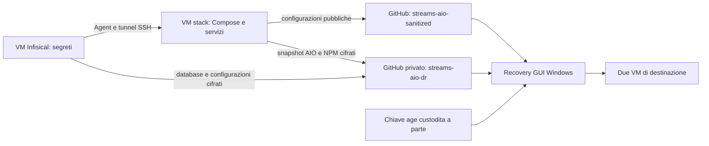
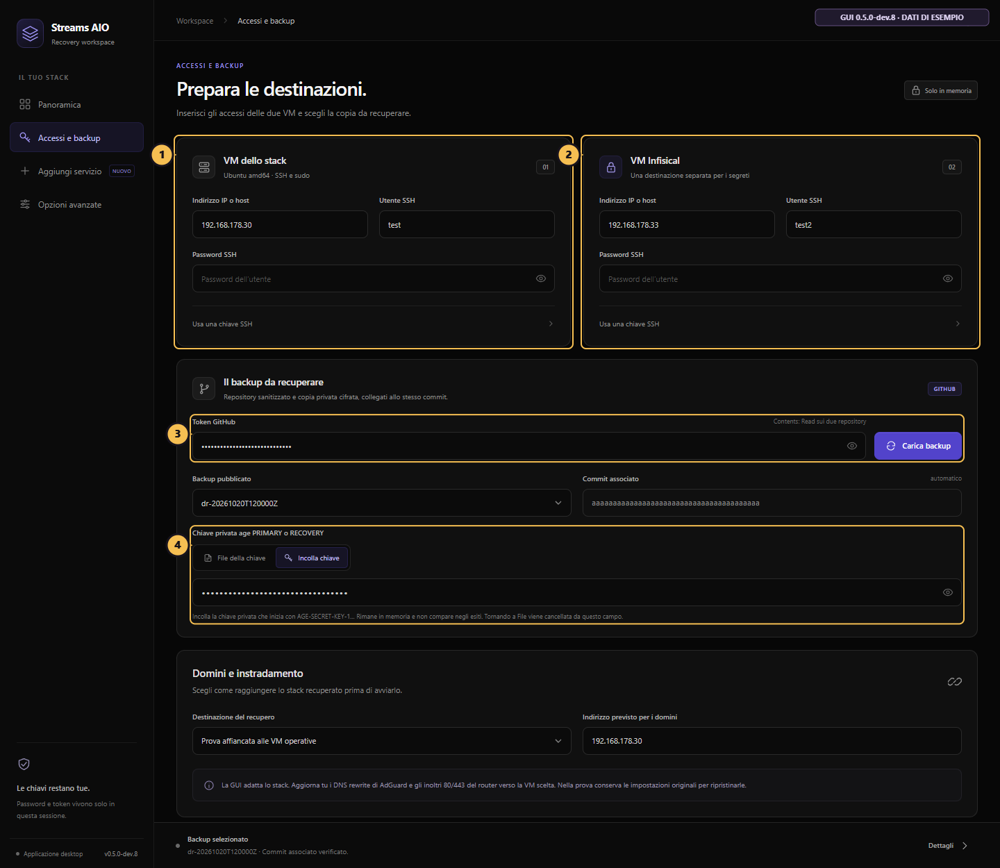
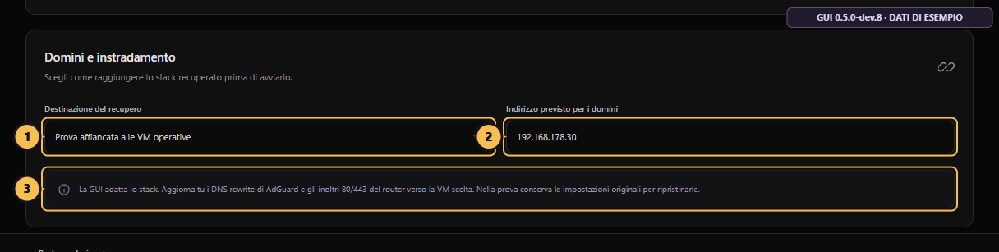
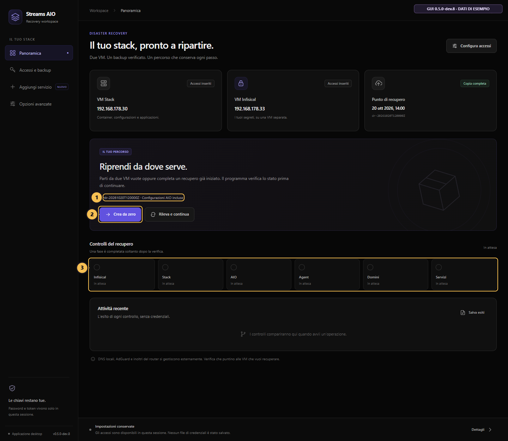
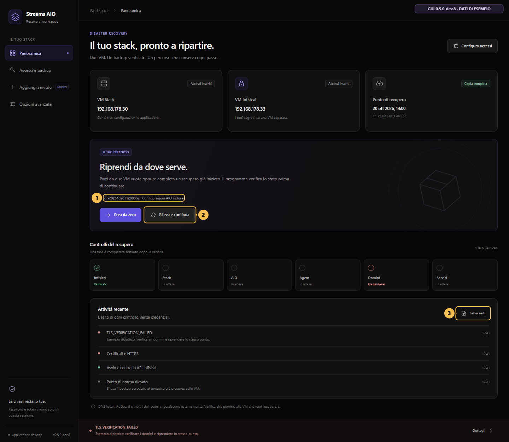
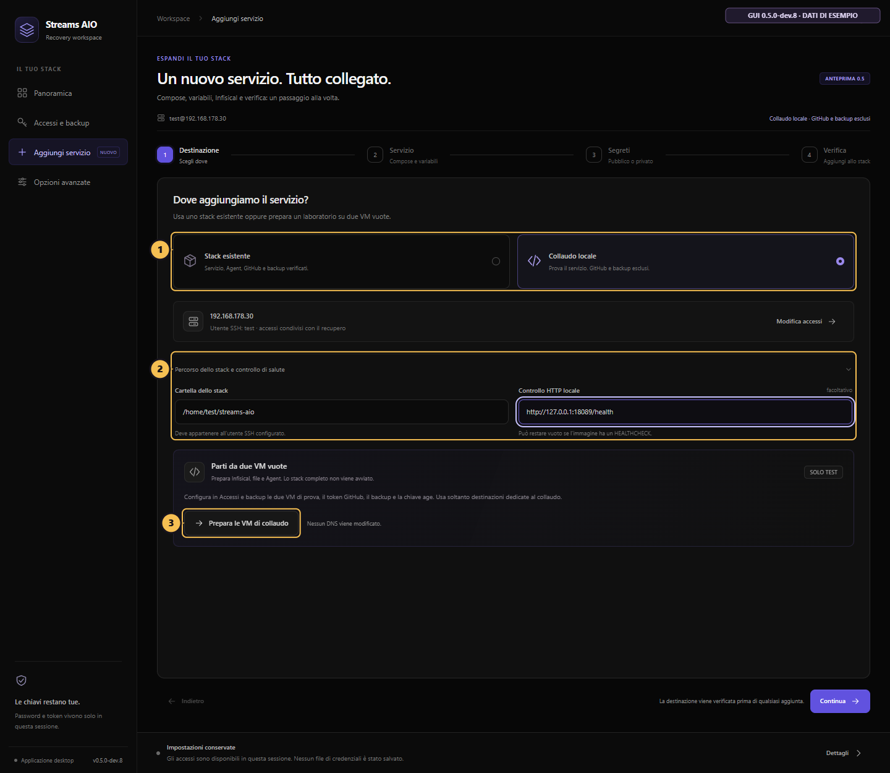
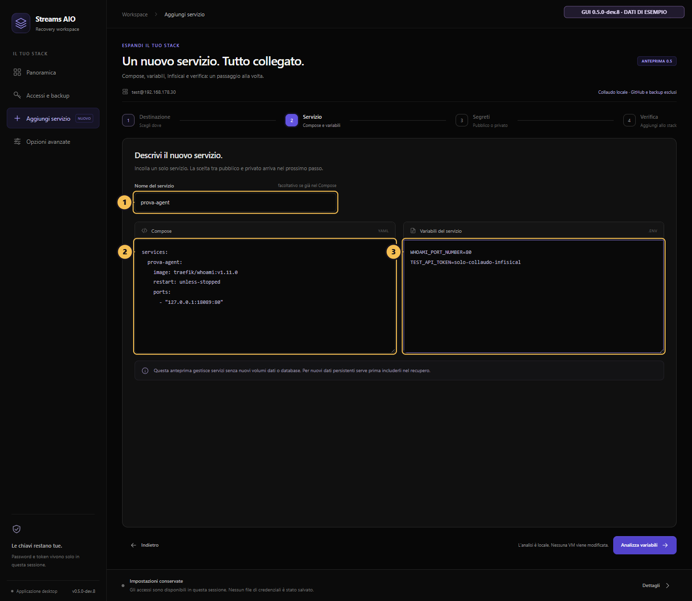
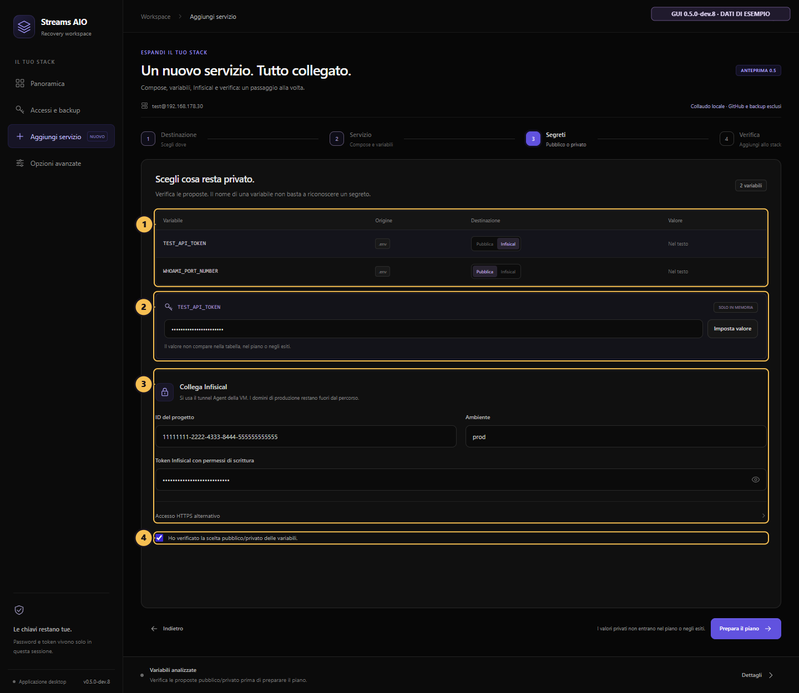
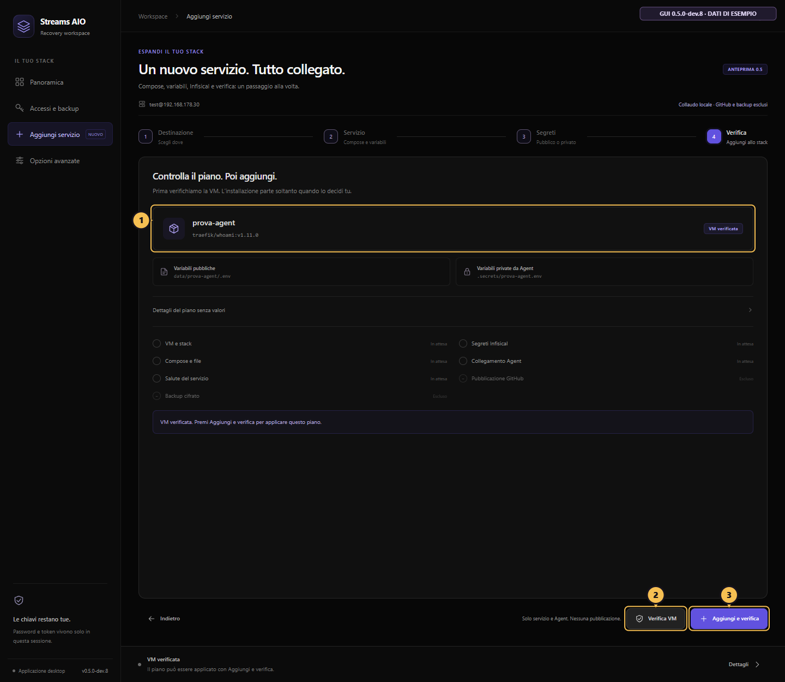
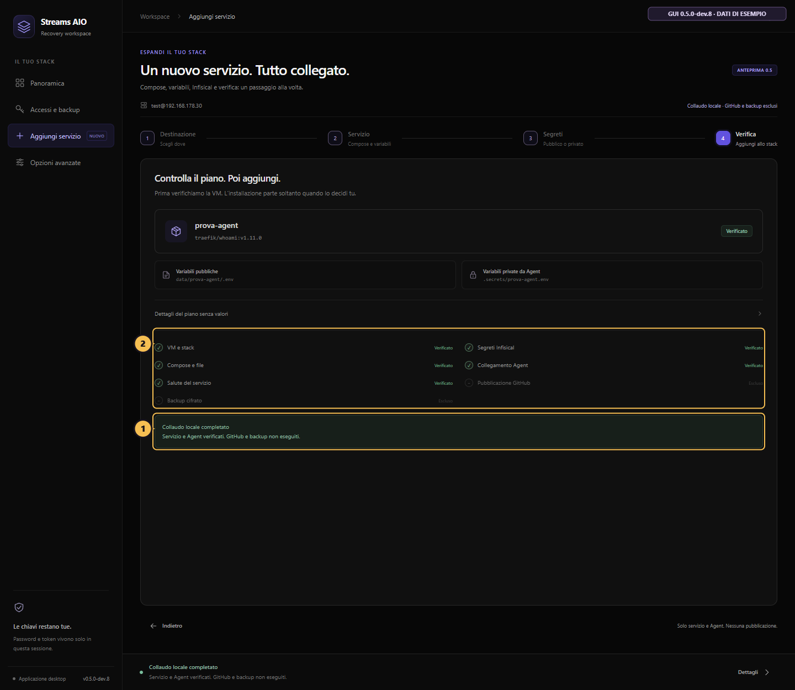

# Streams AIO Recovery

**Guida illustrata in italiano: recupero su due VM, ripresa di un tentativo e aggiunta di un servizio allo stack attivo.**

| Versione | Stato e uso |
| --- | --- |
| **0.4.19 stabile** | [Programma e checksum della release](https://github.com/dav1dera/streams-aio-recovery-gui/releases/tag/v0.4.19). |
| **0.5.0-dev.9 locale, in sviluppo** | Gruppi di servizi, file pubblici, montaggi e dati: [nuova guida](docs/SERVICE-RESOURCES.md). Build di prova, con aggiornamento coordinato dei worker; nessuna nuova prova sulle VM reali attestata. |
| **0.5.0-dev.8 in anteprima** | [Programma, sorgenti e checksum](https://github.com/dav1dera/streams-aio-recovery-gui/releases/tag/v0.5.0-dev.8). Interfaccia scura e scheda **Aggiungi servizio**; [sorgenti su main](https://github.com/dav1dera/streams-aio-recovery-gui/tree/main). Non è una release stabile. |

Le immagini di questa guida mostrano la **0.5.0-dev.8**, con dati dimostrativi e richiami numerati. Sono schermate della vera interfaccia, preparate per spiegare i comandi; non attestano un'esecuzione sulle VM per ciascuna immagine. La versione stabile ha un aspetto diverso.

**Prova reale completata sulla precedente dev.8:** preparazione del laboratorio e aggiunta del servizio `prova-agent` sulle VM `.30` e `.33`, compresi segreto Infisical, Agent e risposta HTTP. **Da completare nell'anteprima:** un nuovo recupero dell'intero stack da VM pulite, la pubblicazione GitHub con nuovo backup e la verifica dopo riavvio.

## Indice

- [1. Come funziona il sistema](#1-come-funziona-il-sistema)
- [2. Prima di iniziare](#2-prima-di-iniziare)
- [3. Accessi e backup](#3-accessi-e-backup)
- [4. Domini, AdGuard e router](#4-domini-adguard-e-router)
- [5. Ripristinare da zero](#5-ripristinare-da-zero)
- [6. Riprendere un recupero interrotto](#6-riprendere-un-recupero-interrotto)
- [7. Aggiungere servizi a una VM già attiva](#7-aggiungere-servizi-a-una-vm-già-attiva)
- [8. Provare l'aggiunta su due VM di laboratorio](#8-provare-laggiunta-su-due-vm-di-laboratorio)
- [9. Modifiche quotidiane, GitHub e backup](#9-modifiche-quotidiane-github-e-backup)
- [10. Cosa contiene il backup e cosa conservare](#10-cosa-contiene-il-backup-e-cosa-conservare)
- [Aggiungere un container: sei passaggi manuali](#aggiungere-un-container-sei-passaggi)
- [Verifiche, limiti e altre guide](#verifiche-limiti-e-altre-guide)

## 1. Come funziona il sistema

La GUI Windows recupera **Infisical su una VM separata** e **Streams AIO sull'altra**. Ripristina le configurazioni previste, i segreti e i database AIO/NPM; installa Agent e tunnel SSH, adatta i collegamenti interni e controlla servizi e HTTPS.



| Componente | Contenuto |
| --- | --- |
| **VM stack** | Applicazioni, NPM, Compose, file pubblici, Agent e, quando installati, worker di sincronizzazione e backup. |
| **VM Infisical** | Backend Infisical, suo PostgreSQL e Redis; sorgente dei valori privati. |
| [streams-aio-sanitized](https://github.com/dav1dera/streams-aio-sanitized) | Compose, configurazioni pubbliche, template e riferimenti alle immagini. |
| **streams-aio-dr**, privato | Strumenti DR e release dei backup cifrati. |
| **Questo repository** | GUI, istruzioni, test e programma Windows. |

**Il progetto è adattato al deployment di riferimento.** Usa `dav1dera/streams-aio-sanitized` e `dav1dera/streams-aio-dr`, con percorsi, identità e contratti di recupero specifici. Non offre un selettore per repository arbitrari. Per realizzare un impianto proprio occorre adattare questi riferimenti e collaudare il primo backup: [setup iniziale](docs/SETUP-DA-ZERO.md). Clonare il repository pubblico non crea i segreti o un backup privato.

## 2. Prima di iniziare

| Occorrente | Requisito |
| --- | --- |
| **Windows** | Eseguibile della versione scelta; nell'anteprima anche Edge WebView2, normalmente presente con Edge. Python non è richiesto. |
| **VM stack** | Ubuntu Server 24.04 o 26.04 amd64, OpenSSH, utente sudo con UID/GID 1000. Indicativamente 4 core, 8 GiB RAM, 80 GiB disco. |
| **VM Infisical** | Stessi requisiti di sistema e un indirizzo distinto. Indicativamente 2 core, 4 GiB RAM, 32 GiB disco. |
| **Recupero completo** | Backup completo schema 2, accesso GitHub e almeno una chiave age privata compatibile. |
| **Rete** | Internet, spazio per immagini e ripristino, DNS e inoltri predisposti per il recupero completo. |

Dimensiona le risorse per il tuo carico. La GUI installa Docker se manca; **non crea le VM e non installa Ubuntu**. [Preparare le VM in Proxmox](docs/PROXMOX.md).

Per l'anteprima scarica dalla [release 0.5.0-dev.8](https://github.com/dav1dera/streams-aio-recovery-gui/releases/tag/v0.5.0-dev.8) **StreamsAIO-Recovery.exe**, **SHA256SUMS** e **PRIMA-DI-INIZIARE.md**. Lo ZIP **streams-aio-recovery-gui-source.zip** serve a chi vuole i sorgenti: non occorre per avviare il programma. Leggi le [istruzioni iniziali](docs/PRIMA-DI-INIZIARE.md) e le [note dell'anteprima](docs/RELEASE-NOTES-v0.5.0-dev.8.md). Il collegamento GitHub «Latest» può continuare a indicare la stabile 0.4.19: scegli il tag dell'anteprima per ottenere l'interfaccia illustrata qui.

Verifica il checksum della stessa release prima di eseguire il programma:

```powershell
Get-FileHash .\StreamsAIO-Recovery.exe -Algorithm SHA256
Get-Content .\SHA256SUMS
```

L'eseguibile non è firmato con Authenticode. Password, token e chiave age incollata restano nella memoria della sessione: chiudendo la GUI vanno reinseriti. Confronta l'impronta SSH con la console della VM quando richiesto; una VM ricreata può avere una nuova chiave anche sullo stesso IP.

## 3. Accessi e backup



**Richiami nell'immagine:** **1** accesso alla VM stack · **2** accesso alla VM Infisical · **3** token GitHub e backup · **4** chiave age.

1. Apri **Accessi e backup**. Inserisci IP attuale, utente e porta SSH di entrambe le VM; usa la password oppure una chiave SSH autorizzata. Compila sudo e passphrase soltanto quando necessari.
2. Inserisci un token GitHub con **Contents: Read** sui due repository di recupero. Non serve scrittura per ripristinare.
3. Premi **Carica backup** e scegli un punto completo. La GUI verifica release e manifest e compila il commit associato.
4. Nel riquadro age scegli **File** oppure, nell'anteprima, **Incolla**. Usa una chiave privata `AGE-SECRET-KEY-1…` PRIMARY o RECOVERY compatibile con quel backup.

**Age, SSH e Infisical sono credenziali diverse.** La chiave pubblica `age1…` non decifra; la parola PRIMARY è solo un'etichetta, non va aggiunta alla chiave. La chiave age non va nel campo SSH. Con accesso SSH tramite password lascia vuoto il campo della chiave SSH.

Con **Incolla**, la GUI usa un campo mascherato e trasferisce la chiave direttamente via SFTP a un file remoto privato `0600`, senza creare un file temporaneo Windows. Non la include in esiti o piani. Conservane comunque una copia protetta fuori dal PC.

Per **aggiungere un servizio allo stack già attivo**, bastano gli accessi SSH della VM stack e, se necessari, quelli API Infisical descritti sotto: **non devi caricare un backup o ripristinare le VM**.

## 4. Domini, AdGuard e router



**Richiami:** **1** modalità · **2** indirizzo previsto · **3** promemoria DNS e router.

Questa preparazione è **manuale**. La GUI adatta i collegamenti interni allo stack, ma **non modifica AdGuard, i DNS di sistema Ubuntu o il router**. Il campo dell'indirizzo previsto verifica l'instradamento; non lo crea.

1. Nel DNS locale/AdGuard porta i domini recuperati all'**IP della VM stack**, dove gira NPM. Controlla anche i record espliciti di Headscale e Infisical: possono prevalere sul wildcard.
2. Anche il **dominio HTTPS Infisical** raggiunge NPM sulla VM stack, che inoltra alla VM Infisical separata. Non puntarlo direttamente al database.
3. Nel router inoltra **TCP 80 e 443 alla sola VM stack**. Adegua separatamente le altre porte realmente necessarie.
4. Verifica DNS pubblico, firewall, provider dei certificati, VPN e NAT loopback. I nomi devono funzionare da client, VM e container, incluso Gluetun. Una modifica al solo file `hosts` di Windows non basta.

Esempio con stack `.30` e Infisical `.33`: i domini AIO, Headscale e il dominio HTTPS Infisical raggiungono **`.30`**; il collegamento privato di Infisical raggiunge **`.33`**. Gli indirizzi sono esempi, non vincoli del programma.

| Modalità | Effetto |
| --- | --- |
| **Prova affiancata alle VM operative** | Recupera lo stack escludendo DDNS, WUD/Watchtower e Deunhealth. Richiede comunque un percorso DNS e di rete verso la VM di prova. |
| **Recupero della produzione** | Completa anche l'avvio dei controller pubblici, per ultimi. Prima di usare gli stessi domini spegni le originali ed evita istanze concorrenti. |

La prova affiancata non genera domini nuovi né isolamento automatico: spostando gli stessi DNS e inoltri sposti il traffico. Per una prova completa in modalità produzione puoi spegnere temporaneamente le originali, conservando i valori da ripristinare.

## 5. Ripristinare da zero



**Richiami:** **1** punto selezionato · **2** Crea da zero · **3** avanzamento dei controlli.

1. Prepara **due VM vuote di applicazioni, volumi e precedenti recuperi**. Se puoi, crea uno snapshot Ubuntu pulito prima della prova. Docker può essere già installato.
2. Compila [Accessi e backup](#3-accessi-e-backup), poi [domini e instradamento](#4-domini-adguard-e-router).
3. Per sostituire le originali, spegnile e verifica DNS e porte verso la destinazione. Per collaudare tutti i controller scegli **Recupero della produzione** con le stesse precauzioni.
4. Apri **Panoramica**, controlla ancora le due VM e il backup, poi premi **Crea da zero** una volta.
5. Lascia PC e VM accesi e attendi l'esito. Non eseguire un secondo recupero o modifiche parallele.

La GUI recupera prima Infisical, poi lo stack e i database previsti; installa Agent e tunnel persistenti, adatta i collegamenti tra le VM e verifica immagini, servizi, NPM, HTTPS, Headscale/Headplane, Tailscale e CometNet. Una fase diventa verificata dopo il suo controllo.

**Crea da zero non cancella un'installazione esistente.** Se trova un tentativo riconoscibile, usa il percorso di ripresa. Se la VM proviene dal laboratorio **Collaudo locale**, riparti dal suo snapshot pulito prima del recupero completo: il laboratorio ha uno stato e finalità diversi.

### Dopo il completamento

- Accedi a Infisical, NPM, AIOStreams e AIOMetadata; controlla profili e integrazioni e prova gli addon in Stremio.
- Prova HTTPS e la funzione reale delle applicazioni dai dispositivi previsti. Un container sano non prova che il client raggiunga l'addon.
- NPM può conservare proxy verso altri dispositivi: il recupero delle due VM non ricrea quei server. Gli avvisi esterni vanno valutati singolarmente.
- Riavvia **entrambe le VM** e ripeti le prove di Agent, tunnel e applicazioni per verificare la persistenza nel tuo ambiente.
- **Dopo una sostituzione definitiva reinstalla e verifica i worker di sincronizzazione pubblica e backup DR: il recupero completo non li reinstalla automaticamente.** Segui le [istruzioni del worker pubblico](https://github.com/dav1dera/streams-aio-sanitized#attivare-la-sincronizzazione) e le [istruzioni DR](https://github.com/dav1dera/streams-aio-dr#install-on-docker-stack), quindi verifica un nuovo backup pubblicato.

Per tornare alle originali dopo una prova: spegni le VM recuperate, ripristina DNS/rewrite e inoltri router, poi riaccendi le originali. Evita due gruppi di controller o due coordinatori DR attivi sullo stesso ambiente.

## 6. Riprendere un recupero interrotto



**Richiami:** **1** stesso backup · **2** Rileva e continua · **3** Salva esiti.

1. Conserva le VM e i checkpoint. Premi **Salva esiti** e leggi il codice e il passo che si è fermato.
2. Correggi la causa indicata: accessi SSH, spazio, instradamento o configurazione richiesta. Non cancellare checkpoint o database per superare il controllo.
3. Se hai chiuso la GUI, reinserisci gli accessi e scegli **lo stesso backup del tentativo**, anche se ne esiste uno più recente. Il suo commit si aggiorna dal manifest.
4. In **Panoramica** premi **Rileva e continua**, oppure il pulsante di ripresa nell'errore. Attendi la verifica di proprietà, identità e punto remoto.
5. La GUI riprende solo lo stato riconosciuto; un backup o una macchina incompatibili vengono conservati e rifiutati.

| Messaggio | Controllo da fare |
| --- | --- |
| **EXISTING_STACK_REFUSED** | Hai usato Crea da zero su un tentativo esistente: passa a Rileva e continua. |
| **FOREIGN_RECOVERY_STATE / errore di scope** | Confronta VM, backup e commit con quelli originali del tentativo. Non forzare la proprietà. |
| **Errore SSH** | Leggi la VM coinvolta; verifica IP, porta, utente, password/chiave e impronta. Una porta 22 aperta non prova l'autenticazione. |
| **TLS / dominio / DNS Headscale** | Controlla l'intero percorso DNS → router → NPM della nuova VM. Un pannello della vecchia VM raggiungibile non prova il recupero. |
| **APPLICATION_HEALTH_WAIT_FAILED** | Salva il report e identifica il servizio e il controllo falliti. Non considerare tutti i container pronti perché sono in esecuzione. |

Se funziona dal telefono e non da Windows, confronta DNS del client, cache, DNS sicuro e VPN. Potrebbero raggiungere destinazioni diverse. [Diagnostica dettagliata](docs/USAGE.md).

## 7. Aggiungere servizi a una VM già attiva

**Non serve un ripristino.** Questa procedura aggiunge un servizio nuovo allo stack attuale; non ripristina un backup sopra i database esistenti e non avvia nuovamente tutto lo stack.

L'anteprima supporta servizi **senza dati persistenti propri**, definiti in Compose e `.env`. Rifiuta mount, socket Docker, immagini con volumi anonimi, `build`, `include`, `extends` e anchor YAML. Un nuovo database o file di configurazione aggiuntivo richiede un percorso dedicato. Leggi [uso e limiti dell'anteprima](docs/AGGIUNGI-SERVIZIO.md).

### 7.1 Destinazione: scegli lo stack attuale



**Richiami:** **1** tipo di destinazione · **2** cartella e controllo HTTP · **3** preparazione riservata al laboratorio. La schermata mostra anche il riquadro di laboratorio: su una VM attiva seleziona **Stack esistente**.

1. In **Accessi e backup** inserisci l'accesso SSH della VM stack attuale. Non occorre scegliere un backup o compilare la seconda VM per questa aggiunta.
2. Apri **Aggiungi servizio → Destinazione** e scegli **Stack esistente**, per il percorso completo con pubblicazione e backup.
3. Indica la cartella reale, per esempio `/home/pi/streams-aio`. Agent, worker pubblico e coordinatore DR devono essere già installati e funzionanti sulla VM.
4. Se il servizio non offre Docker HEALTHCHECK, inserisci un endpoint HTTP locale della **VM stack**. Per l'esempio sotto: `http://127.0.0.1:18089/health`.

Quell'URL va nel campo **Controllo HTTP locale**, non nel browser Windows. La GUI lo prova sulla VM dopo aver avviato il servizio. Non premere **Prepara le VM di collaudo** su uno stack attivo.

### 7.2 Servizio: inserisci Compose e variabili



**Richiami:** **1** nome nuovo · **2** Compose · **3** variabili del servizio.

Esempio usato nel collaudo locale, con un segreto fittizio destinato a verificare il collegamento all'Agent:

**Nome:** `prova-agent`

```yaml
services:
  prova-agent:
    image: traefik/whoami:v1.11.0
    restart: unless-stopped
    ports:
      - "127.0.0.1:18089:80"
```

**Variabili del servizio (.ENV):**

```dotenv
WHOAMI_PORT_NUMBER=80
TEST_API_TOKEN=solo-collaudo-infisical
```

Scegli un nome e una porta liberi. Non riusare `prova-agent` se esiste già da una prova precedente. Il valore `TEST_API_TOKEN` serve soltanto al test Infisical → Agent → container; non abilita un'autenticazione in whoami.

### 7.3 Segreti: conferma pubblico/privato e collega Infisical



**Richiami:** **1** classificazione · **2** valore privato mascherato · **3** progetto, ambiente e token · **4** conferma della revisione.

1. Premi **Analizza variabili** e conferma `WHOAMI_PORT_NUMBER` **Pubblica**, `TEST_API_TOKEN` **Infisical** (valore privato). I suggerimenti dal nome non sostituiscono la tua verifica.
2. Se richiesto, inserisci il valore nel campo mascherato e premi **Imposta valore**. Non mettere credenziali negli env pubblici.
3. Inserisci **Project ID**, ambiente `prod` e un **access token Infisical** autorizzato a leggere e creare cartelle e segreti. Il token GitHub e il Client Secret Universal Auth non sono quel token.
4. Per generare il token: nell'organizzazione apri **Access Control → Machine Identities → Create** e crea un'identità dedicata. Nella sua sezione Authentication sostituisci Universal Auth con **Token Auth**, poi premi **Add Token**. Nel progetto apri **Access Control → Machine Identities → Assign Existing** e assegnale **Member**, oppure un ruolo dedicato con i permessi necessari. Modifica soltanto la nuova identità, lasciando invariata quella dell'Agent. [Istruzioni ufficiali Token Auth](https://infisical.com/docs/documentation/platform/identities/token-auth).
5. Verifica che l'identità dell'Agent possa già leggere `/<nome-servizio>`. La GUI non amplia automaticamente i suoi permessi.
6. Lascia **HTTPS alternativo** vuoto quando l'Agent ha un tunnel riconosciuto. Le API usano quel tunnel attraverso la connessione SSH alla VM stack; altrimenti serve l'HTTPS corretto dell'istanza Infisical.
7. Conferma **Ho verificato la scelta pubblico/privato delle variabili** e premi **Prepara il piano**.

Nel laboratorio usa l'Infisical di prova: per esempio `.33`. Il suo pannello può essere `http://192.168.178.33/` se il backend è pubblicato sulla porta 80. La porta `18089` dell'esempio appartiene al nuovo servizio sulla VM **stack**, non a Infisical.

### 7.4 Verifica: controlla prima, poi applica



**Richiami:** **1** piano e percorsi · **2** Verifica VM · **3** Aggiungi e verifica.

1. Premi **Verifica VM**. Controlla impronta, conflitti di nomi/porte/file e accesso ai segreti. Un secret già presente viene riusato solo se il valore coincide; non viene sovrascritto.
2. Se il controllo riesce, premi **Aggiungi e verifica** una volta e attendi. La GUI crea i segreti mancanti, aggiunge il servizio, collega l'Agent e verifica il valore generato. Avvia **soltanto il nuovo servizio**.
3. I valori pubblici vanno in `data/<servizio>/.env`; quelli privati vengono generati in `.secrets/<servizio>.env`. I commenti dei file esistenti restano conservati; il piano esportabile non include i valori.
4. Nel percorso completo richiede poi sincronizzazione e nuovo backup, rileggendo manifest, commit e allegati cifrati per verificarli. Considera completo il salvataggio solo con il **tag del nuovo backup verificato**.

Se resta da fare soltanto pubblicazione o backup, nella **stessa sessione** puoi verificare e riprendere lo stesso piano. La ripresa automatica dell'aggiunta dopo la chiusura della GUI non è ancora disponibile. Dopo un errore di avvio conserva lo stato e gli esiti: non rilanciare alla cieca con un altro nome.

## 8. Provare l'aggiunta su due VM di laboratorio



**Richiami:** **1** servizio e Agent verificati · **2** GitHub e backup esclusi.

1. Crea uno snapshot delle due VM Ubuntu pulite. In **Accessi e backup** compila entrambe e carica un backup completo con la relativa chiave age.
2. In **Aggiungi servizio → Destinazione** scegli **Collaudo locale** e premi **Prepara le VM di collaudo**: il riquadro è indicato nel [richiamo 3 della schermata Destinazione](docs/screenshots/v050-dev8/09-destinazione.png).
3. Attendi **File e Agent preparati**. Infisical viene avviato sulla propria VM; i file dello stack e l'Agent vengono preparati sull'altra. **L'intero stack applicativo non viene avviato.**
4. Mantieni il collaudo locale, usa la cartella `/home/test/streams-aio` se l'utente della VM stack è `test`, e segui [Servizio → Segreti → Verifica](#72-servizio-inserisci-compose-e-variabili).
5. L'esito **Collaudo locale completato** verifica il nuovo servizio e l'Agent. GitHub e backup sono **esclusi**, non superati. Le originali possono restare attive; per questa prova non servono modifiche a DNS o router.

Una preparazione interrotta si riprende dallo stesso pulsante con **lo stesso backup**; la GUI verifica entrambe le VM prima di proseguire. Un contrassegno protetto impedisce di pubblicare dal laboratorio nei repository principali. Per testare **Crea da zero e tutto lo stack**, ripristina gli snapshot puliti e segui la sezione 5: non convertire il laboratorio eliminandone i checkpoint.

## 9. Modifiche quotidiane, GitHub e backup

| Dato | Dove si modifica |
| --- | --- |
| IP interni, subnet Docker, porte, opzioni e URL senza credenziali | Compose e normali `.env`, `.conf`, JSON, YAML o TOML dello stack. |
| Password, token, chiavi API, chiavi applicative e URL con credenziali | Infisical; l'Agent genera i file privati previsti dai mapping. |

I file pubblici restano modificabili sulla VM, con commenti e formattazione. Non modificare a mano un file privato generato dall'Agent: cambia la sorgente Infisical. La classificazione usa percorsi ammessi, template e associazioni esplicite; **non indovina infallibilmente i segreti dai nomi**. Un file escluso dal pubblico non entra automaticamente nel backup cifrato.

Nel deployment di riferimento: sincronizzazione pubblica **circa ogni 15 minuti**; backup DR **alle 04:30 Europe/Rome**, con ritardo fino a 10 minuti e ultimi cinque punti verificati; WUD **alle 05:00**, con Gluetun escluso. Sono orari dei processi installati sulla VM, non del programma Windows.

La direzione è **VM → GitHub**. Un commit GitHub non distribuisce automaticamente modifiche ai container. Un cambio di env/secret può richiedere la ricreazione del servizio. Ogni backup è una fotografia: le release precedenti non ricevono i valori nuovi.

```bash
# Prossime esecuzioni e risultato dell'ultimo passaggio, senza stampare segreti.
systemctl list-timers streams-aio-public-sync.timer streams-aio-dr.timer --no-pager --full
systemctl show streams-aio-public-sync.service streams-aio-dr.service \
  -p Id -p Result -p ExecMainStatus -p ExecMainExitTimestamp

# Per anticipare: attendi che la prima operazione finisca, poi avvia la seconda.
sudo systemctl start streams-aio-public-sync.service
sudo systemctl start streams-aio-dr.service
```

Controlla `Result=success`, `ExecMainStatus=0`, commit pubblico e nuova release completa. Un servizio a esecuzione singola può essere `inactive` dopo il successo; un timer attivo non prova che il backup sia riuscito. Le unità attuali non inviano notifiche automatiche di errore.

**Honey:** il worker aggiornato conserva i binding tramite riferimenti pubblici univoci, non tramite il numero della riga. Rimozioni o associazioni ambigue fermano la sincronizzazione con `HONEY_BOUND_LAYOUT_REVIEW_REQUIRED`, per evitare spostamenti di valori privati. Serve il worker aggiornato sulla VM, non soltanto una GUI nuova. [Esempi e contratti del worker](https://github.com/dav1dera/streams-aio-sanitized/blob/main/docs/ESEMPI-PRATICI.md).

## 10. Cosa contiene il backup e cosa conservare

Una release completa **schema 2** contiene otto file:

| File | Contenuto |
| --- | --- |
| `aio-state.tar.gz.age` | Snapshot SQLite nativi AIOStreams/AIOMetadata, identità, profili e configurazioni necessari al recupero. |
| `npm-database.sqlite.age` | Database NPM: utenti, access list e proxy. |
| `infisical-agent-infisical-agent.tar.gz.age` | Configurazione e credenziali di bootstrap dell'Agent. |
| `infisical-config.tar.gz.age` | Configurazione privata del server Infisical. |
| `infisical-postgres.dump.age` | Database Infisical e secret al momento della cattura. |
| `infisical-postgres-globals.sql.age` | Ruoli PostgreSQL di Infisical. |
| `manifest.json` | Inventario, checksum e commit associati. |
| `SHA256SUMS` | Checksum del manifest e degli artifact cifrati. |

Il Compose e le configurazioni pubbliche arrivano dal **commit esatto del manifest**. Le immagini sono confrontate con i riferimenti immutabili del punto selezionato; un aggiornamento del digest non impone le immagini del vecchio collaudo. Restano i requisiti di piattaforma, repository e compatibilità dei dati: **non è una migrazione automatica tra versioni principali PostgreSQL**. Infisical mantiene un proprio profilo compatibile.

Non servono export JSON AIO o payload integrativi nel percorso normale. Non sono salvati tutti i volumi Docker o tutto PostgreSQL applicativo: database/cache dichiarati ricostruibili, fra cui Comet, CometNet, StremThru e Redis, ripartono vuoti. Le catture non costituiscono una transazione unica simultanea. Un backup VM/PBS è una protezione complementare.

Conserva fuori dal PC: **chiavi age private PRIMARY e RECOVERY** in copie protette e separate, programma/checksum/sorgenti/guida, gli otto file di un punto verificato con riferimento al commit e gli accessi con recupero MFA a GitHub, DNS, router e provider. Basta una chiave compatibile per decifrare; perderle entrambe rende inutilizzabili le copie cifrate. Un token GitHub può essere ricreato. Non caricare il kit con le chiavi private su GitHub.

La GUI richiede GitHub e Internet: non offre un'importazione interamente offline e il kit non include tutte le immagini Docker o i pacchetti. **Aggiungere un servizio non aggiunge automaticamente il backup del suo database.**

## Aggiungere un container: sei passaggi

Questo riferimento **manuale** resta per chi modifica lo stack senza la nuova scheda. Per l'esempio illustrato usa invece la [sezione 7](#7-aggiungere-servizi-a-una-vm-già-attiva). Percorsi e progetto sotto sono quelli del deployment di riferimento.

1. **Prepara il servizio.** Crea `data/nuovo-servizio/.env` con soli valori pubblici; prepara directory e UID/GID se necessari. Decidi esplicitamente quali dati richiedano backup e ripristino dedicati.
2. **Crea i secret e il mapping.** In Infisical, progetto `streams-aio`, ambiente `prod`, crea `/nuovo-servizio/API_TOKEN`; autorizza la lettura all'Agent. Aggiungi sotto `templates:` della configurazione Agent esistente la voce seguente, conservando quelle precedenti.

```yaml
  - template-content: |
      API_TOKEN={{ with getSecretByName "f80601b1-73fb-49bd-9373-f3687cd5c8eb" "prod" "/nuovo-servizio" "API_TOKEN" }}{{ .Value | replace "$" "$$" | printf "%q" }}{{ end }}
    destination-path: /home/pi/streams-aio/.secrets/nuovo-servizio.env
    config:
      polling-interval: 60s
```

3. **Verifica l'Agent.** Riavvia `infisical-agent.service`, attendi il file privato e verifica proprietario e permessi senza stamparne il contenuto: tipicamente `640 root:pi` sull'originale o `600` dell'utente di deployment dopo il recupero. Non usare `644`. Con caratteri particolari verifica l'equivalenza Infisical → Agent → Compose → renderer DR usando valori fittizi. Non aggiungere `format: raw` senza collaudare il DR.
4. **Collega Compose.** Nel nuovo servizio aggiungi `env_file: [./data/nuovo-servizio/.env, ./.secrets/nuovo-servizio.env]`, immagine, reti, porte, restart e healthcheck appropriati. I file del servizio non alimentano l'interpolazione `${VAR}` del Compose. Per WUD, quando adatto, usa `wud.tag.include: '^$${raw}$$'` e `wud.watch.digest: 'true'`; per escludere usa `wud.watch: 'false'`. Le label valgono dopo aver ricreato il container.
5. **Valida e avvia solo il servizio.** Esegui i controlli seguenti, interrompendoti se un passaggio fallisce. Dipendenze e database devono già essere disponibili.

```bash
cd /home/pi/streams-aio
test -s .secrets/nuovo-servizio.env
docker compose --profile all config --quiet
docker compose --profile all pull nuovo-servizio
docker compose --profile all up -d --no-deps nuovo-servizio
docker compose --profile all ps nuovo-servizio
```

6. **Prova e salva.** Verifica la funzione reale, sincronizza la parte pubblica e crea un nuovo backup come nella sezione 9. Controlla commit, sei `.age`, manifest/checksum e associazione corretta. Il template Agent è la sorgente privata: il worker lo conserva nel backup e la GUI 0.4.19 può generare i nuovi `.secrets/*.env` prima di validare Compose, senza aggiungere a mano `env_files` o `required_values` su GitHub. Le directory dati nuove non vengono salvate automaticamente.

## Verifiche, limiti e altre guide

| Percorso | Evidenza disponibile |
| --- | --- |
| **Anteprima 0.5.0-dev.8: laboratorio** | Preparazione e aggiunta reale di `prova-agent` riuscite su `.30`/`test` e `.33`/`test2`: Infisical, mapping Agent e salute HTTP verificati. GitHub e backup esclusi dalla prova. |
| **Anteprima 0.5.0-dev.8: recupero completo** | Ancora da collaudare da VM pulite e dopo riavvio, insieme alla pubblicazione e al nuovo backup nel percorso completo di aggiunta. |
| **Stabile 0.4.19** | Generazione iniziale dei nuovi env privati dai template Agent; 790 test raccolti, 741 riusciti e 49 saltati su Windows. Nessun nuovo recupero completo attestato da questa sola suite. |
| **Recupero 0.4.17 del 14 ottobre 2026** | Completato con `dr-20261013T023710Z` su VM pulite dei dati precedenti, con Docker/cache già presenti. Addon AIO confermati da telefono; riavvio e tutte le integrazioni esterne non completati in quella prova. |

L'anteprima rifiuta valori privati con apostrofo, righe multiple, caratteri di controllo o backslash finale; `$` è supportato. Non alterare una credenziale valida per aggirare un limite: occorre estendere e collaudare insieme Agent e ripristino. Le identità, le immagini, i permessi e il punto di recupero restano verificati; non sono garantiti cambi arbitrari di versione o struttura dei database.

**Guide:** [Prima di iniziare](docs/PRIMA-DI-INIZIARE.md) · [Setup da zero](docs/SETUP-DA-ZERO.md) · [Uso dettagliato](docs/USAGE.md) · [Aggiungi servizio](docs/AGGIUNGI-SERVIZIO.md) · [Proxmox](docs/PROXMOX.md) · [Note 0.5.0-dev.8](docs/RELEASE-NOTES-v0.5.0-dev.8.md) · [Note 0.4.19](docs/RELEASE-NOTES-v0.4.19.md).

**Sviluppo:** backend Python e SSH, interfaccia WebView2 nell'anteprima e Tk nella versione classica. `build.ps1` crea l'eseguibile; `tests/` e GitHub Actions controllano codice, compatibilità Ubuntu e build Windows. Le immagini documentali usano dati dimostrativi, senza credenziali. I test automatici non sostituiscono il collaudo del proprio ambiente.
