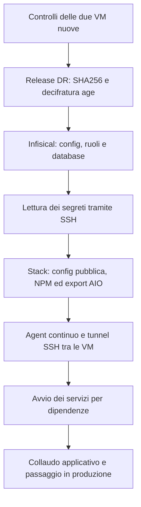

# Guida completa · Streams AIO Recovery 0.3.2

**Ricostruisci Infisical e lo stack Streams AIO su due VM nuove, da Windows.** Inserisci gli accessi SSH, scegli i backup e premi **Ripristina entrambe le VM**: il programma installa Docker, recupera Infisical, prepara lo stack e configura l’Agent continuo.

[Scarica v0.3.2](https://github.com/dav1dera/streams-aio-recovery-gui/releases/tag/v0.3.2) · [Backup DR privati](https://github.com/dav1dera/streams-aio-dr/releases) · [Runbook dello stack](https://github.com/dav1dera/streams-aio-sanitized/blob/main/docs/DISASTER-RECOVERY.md)

**Stato:** test Linux, ripristino PostgreSQL 14 con dati sintetici, compilazione e avvio Windows superati. Il collaudo completo con i backup reali sulle due VM resta da eseguire. Servizi avviati e ripristino funzionale sono risultati distinti.

[Torna al README illustrato](../README.md) · [Schermate reali](screenshots/README.md)

## Percorso rapido

1. Crea **due VM vuote Ubuntu Server 26.04 LTS amd64** (anche 24.04 LTS), con SSH e un utente UID/GID 1000 abilitato a sudo. [Istruzioni Proxmox e ISO già caricata](PROXMOX.md).
2. Prepara sul PC token GitHub di lettura, chiave privata age ed export AIO.
3. Apri `StreamsAIO-Recovery.exe` e compila le prime tre schede.
4. Premi **Verifica**, controlla release e commit, conferma le destinazioni nuove e premi **Ripristina entrambe le VM**.
5. Al termine verifica login, Agent, applicazioni e collegamenti. Riattiva le automazioni di produzione soltanto dopo il collaudo e il passaggio alle nuove VM.

## 1. Cosa preparare

| Cosa | Dove / requisito |
| --- | --- |
| Programma | `StreamsAIO-Recovery.exe` nella release privata. Python sul PC non serve. |
| VM stack | Ubuntu Server **26.04 LTS amd64** oppure **24.04 LTS amd64**, vuota, con SSH e sudo. |
| VM Infisical | Una seconda VM con gli stessi requisiti. La VM originale Fedora resta intatta. |
| Accessi SSH | IP/host, porta, utente e password oppure chiave privata SSH per ciascuna VM. |
| Token GitHub | Fine-grained token con **Contents: Read** per `streams-aio-dr` e `streams-aio-sanitized`. |
| Release DR | Una release `dr-…` pubblicata nel repository privato dei backup. |
| Chiave age | File identity privato PRIMARY o RECOVERY, custodito fuori da Git e dalle VM. |
| Input AIO | Export JSON logici **AIOStreams 2.35.3** e **AIOMetadata 3.3.0**, oppure `PRIVATE_DR_PAYLOAD` completo. |
| Binding AIO | Registro `/dr/AIO_PROFILE_BINDINGS` presente nell’Infisical recuperato. |

Gli export AIO **non sono inclusi nei backup DR automatici**: conservali separatamente in modo privato e recuperabile. Esportali attraverso le applicazioni; per profili multipli e payload segui il [contratto AIO di export/import](https://github.com/dav1dera/streams-aio-sanitized/blob/main/docs/AIO-EXPORT-IMPORT.md). SQLite grezzi e archivi non sostituiscono questi JSON.

Per la prima prova conserva le VM operative e assegna alle nuove VM IP diversi. Il programma rifiuta host con container, volumi o deployment preesistenti, anche se spenti. Non è un programma per aggiornare uno stack già operativo.

Le nuove VM devono raggiungere Internet. Il PC deve raggiungerle entrambe via SSH; per l’Agent continuo anche la VM stack deve raggiungere via SSH la nuova VM Infisical.

### Preparare le VM

Puoi usare la ISO `ubuntu-26.04.1-live-server-amd64.iso` già caricata su Proxmox. Le point release 26.04.x sono identificate da Ubuntu come `VERSION_ID=26.04`. Scarica **v0.3.1 o successivo**: il vecchio eseguibile v0.3.0 continua a rifiutare 26.04 anche se la guida è aggiornata.

Il programma accetta esplicitamente Ubuntu 26.04 (`resolute`) e 24.04 (`noble`), su amd64. Fedora e altre versioni restano escluse. Il repository Docker segue il sistema installato, come previsto dalle [istruzioni ufficiali Docker](https://docs.docker.com/engine/install/ubuntu/).

Durante l’installazione Ubuntu abilita **OpenSSH server**. Crea gli utenti che userai nel programma, per esempio `pi` sullo stack e `infiscal` su Infisical. Entrambi devono avere UID e GID 1000.

Sulla console di **ciascuna VM nuova** verifica:

```bash
id -u
id -g
sudo -v
hostname -I
systemctl is-active ssh.service --no-pager
```

I primi due risultati devono essere `1000`, sudo deve riuscire e SSH deve risultare `active`. Annota l’IP. Non occorre installare Docker a mano.

Al primo collegamento la GUI chiede di riconoscere l’impronta SSH. Confrontala con quelle delle chiavi pubbliche lette dalla console della VM:

```bash
sudo ssh-keygen -lf /etc/ssh/ssh_host_ed25519_key.pub -E sha256
sudo ssh-keygen -lf /etc/ssh/ssh_host_ecdsa_key.pub -E sha256
sudo ssh-keygen -lf /etc/ssh/ssh_host_rsa_key.pub -E sha256
```

Il valore `SHA256:…` mostrato dalla GUI deve corrispondere alla chiave usata dal server. Una chiave già nota e cambiata blocca l’accesso.

### Preparare il token GitHub

1. Accedi con l’account che può leggere i backup privati.
2. Apri **Settings → Developer settings → Personal access tokens → Fine-grained tokens → Generate new token**.
3. Dai un nome al token, per esempio `streams-aio-recovery`, e imposta la scadenza.
4. Scegli **Resource owner: dav1dera** e **Repository access → Only select repositories**: seleziona `streams-aio-dr` e `streams-aio-sanitized`.
5. Assegna **Repository permissions → Contents: Read-only**. Il normale accesso di lettura ai metadati è incluso.
6. Genera il token e inseriscilo nel programma. Non occorrono permessi di scrittura.

Riferimento: [gestione dei token nella documentazione ufficiale GitHub](https://docs.github.com/en/authentication/keeping-your-account-and-data-secure/managing-your-personal-access-tokens#creating-a-fine-grained-personal-access-token).

## 2. Scaricare il programma

Dalla [release v0.3.2](https://github.com/dav1dera/streams-aio-recovery-gui/releases/tag/v0.3.2), scarica `StreamsAIO-Recovery.exe` e `SHA256SUMS`. Devi essere autenticato su GitHub perché la repository è privata.

Apri PowerShell nella cartella del download e verifica:

```powershell
Get-FileHash -Algorithm SHA256 .\StreamsAIO-Recovery.exe
```

Confronta il risultato con la riga dell’eseguibile in `SHA256SUMS`: maiuscole e minuscole non cambiano il digest. Poi apri il programma con un doppio clic. L’eseguibile include Python e SSH; non ha firma Authenticode. Il checksum verifica la corrispondenza con il file pubblicato.

## 3. Compilare il programma: esempio completo

Gli IP **illustrativi** `192.0.2.10` e `192.0.2.11` vanno sostituiti con quelli reali delle due VM nuove.

### Scheda «VM e GitHub»

| Campo | Esempio / istruzione |
| --- | --- |
| Host / IP SSH | `192.0.2.10`: la nuova VM stack. |
| Utente | `pi`, oppure l’utente effettivamente creato. |
| Porta | `22`, se non l’hai cambiata. |
| Password SSH | Password dell’utente. In alternativa seleziona il file della chiave privata SSH. |
| Token GitHub | Il token di lettura preparato sopra. |

Premi **Carica release da GitHub**. Il programma seleziona la release DR pubblicata più recente per timestamp e compila **Commit dello stack** con il commit corrente di `main` del repository pubblico.

Controlla la release e il commit scelti. I due repository sono aggiornati da procedure diverse: non costituiscono uno snapshot atomico. Per uno stato precedente inserisci il commit pubblico completo di 40 caratteri coerente con quella release.

### Scheda «Backup»

- Seleziona il file **Chiave age PRIMARY o RECOVERY**. Serve la identity privata: la stringa pubblica `age1…` non decifra il backup.
- Seleziona uno o più JSON in **AIOStreams** e **AIOMetadata**, usando i pulsanti **Scegli JSON…**.
- In alternativa ai due gruppi, scegli un **PRIVATE_DR_PAYLOAD completo**.

Se hai custodito solo il codice della chiave age, crea con Blocco note un file di testo UTF-8, per esempio `age-primary.txt`, contenente su una sola riga la chiave privata originale completa che inizia con `AGE-SECRET-KEY-1`. Salvalo fuori dalle cartelle Git e selezionalo con **Sfoglia…**. PRIMARY o RECOVERY funzionano se sono tra i recipient del backup scelto; non aggiungere prefissi a un codice sconosciuto e non incollare la chiave nel campo del percorso o negli esiti.

Per più profili, gli export devono essere associabili ai binding in Infisical. Se l’associazione è ambigua il programma si ferma. La versione 0.3 richiede gli export di entrambe le applicazioni oppure un payload completo.

### Scheda «Nuova VM Infisical»

Inserisci `192.0.2.11`, utente `infiscal` o quello effettivo, porta e password oppure chiave SSH della **seconda VM**. Compila passphrase della chiave e password sudo se necessarie.

Il programma recupera Infisical in `/opt/infisical`. Database, chiavi applicative e Universal Auth arrivano dai backup: non devi creare un nuovo progetto o reinserire tutti i secret. Il collegamento API della procedura non richiede di cambiare il DNS.

### Scheda «Opzioni»

Per **Ripristina entrambe le VM** lascia vuoti **Endpoint HTTPS Infisical**, **Project ID**, **Ambiente** e i due **File Universal Auth**. L’endpoint viene collegato via SSH e gli altri dati arrivano dal backup Agent. Con l’Agent continuo attivo, override di progetto, ambiente o Universal Auth vengono rifiutati prima di modificare le VM.

Compila soltanto **Password sudo (se diversa)** e **Passphrase chiave SSH** se servono per la VM stack. I campi equivalenti della seconda VM sono nella scheda **Nuova VM Infisical**.

### Scheda «Ripristino»

1. Premi **Verifica** e riconosci le impronte SSH dopo il confronto con le console.
2. Controlla nuovamente release e commit nella prima scheda. **Verifica conserva un commit già compilato**; quando il campo è vuoto usa il commit pubblico corrente. Il caricamento delle release compila invece il commit corrente: controllalo prima di avviare.
3. Seleziona **Confermo che le VM selezionate sono nuove e destinate a questa prova**.
4. Lascia attiva l’opzione **Installa l’Agent continuo e il tunnel SSH permanente tra le VM**.
5. Per la prima prova lascia disattivata la riemissione TLS: usa Cloudflare/ACME reali e richiede DNS/upstream funzionanti.
6. Premi **Ripristina entrambe le VM**, controlla le due destinazioni nel riepilogo e conferma.

**Verifica** controlla GitHub, SSH, sudo, sistema e destinazioni. Non installa software e non certifica ancora il contenuto dei backup o il funzionamento applicativo: il ripristino effettua ulteriori controlli durante le rispettive fasi.

## 4. Cosa avviene durante il ripristino



Durante l’operazione tieni aperto il programma e mantieni il PC collegato alle VM. **Interrompi** o la chiusura della GUI interrompono la connessione; non annullano le scritture già effettuate. Materiale e checkpoint vengono conservati.

| Pulsante | Quando usarlo |
| --- | --- |
| **Verifica** | Controlla connessioni e destinazioni prima di iniziare. |
| **Ripristina entrambe le VM** | Percorso normale: recupera Infisical, prepara lo stack, installa l’Agent e avvia i servizi. |
| **Prepara stack** | Modalità separata quando Infisical è già disponibile via HTTPS. Non avvia i servizi applicativi né installa l’Agent continuo. |
| **Avvia servizi** | Avvio separato su uno stack preparato con successo dalla GUI sulla stessa VM. Il pulsante unico lo esegue già. |
| **Salva esiti** | Esporta passi, stati e codici senza credenziali o contenuti dei file. |
| **Interrompi** | Interrompe la connessione; non effettua un rollback. |

## 5. Cosa recupera e cosa riparte vuoto

| Componente | Comportamento |
| --- | --- |
| Infisical | Config privata, chiavi applicative, ruoli e database con owner/grant originali. |
| Redis di Infisical | Riparte vuoto. |
| Agent | Universal Auth e mapping `.secrets`; CLI **0.43.137** e servizio continuo. |
| Stack | Compose, immagini e config dal commit pubblico; secret dal nuovo Infisical. |
| NPM | Database cifrato; riemissione/verifica TLS opzionali. |
| AIOStreams / AIOMetadata | JSON o payload forniti dal PC; alcuni account/OAuth possono richiedere riautorizzazione. |
| Altri dati runtime/database | Inizializzati secondo il piano dello stack, senza clonare tutti i dati originali. |
| Timer pubblici/privati | Restano disattivati sulla prova. |
| Watchtower, Cloudflare DDNS, deunhealth | Esclusi dall’avvio della prova. |

## 6. Controlli da fare alla fine

- Accedi al nuovo Infisical e verifica progetto e secret attesi.
- Controlla che lo stack legga i secret dal **nuovo** Infisical.
- Verifica Agent e tunnel; chiudi il programma Windows e controlla che restino attivi.
- Apri NPM, controlla proxy host e upstream; verifica DNS/HTTPS quando il routing di prova è pronto.
- Apri AIOStreams e AIOMetadata: verifica profili/import, accessi e collegamenti, completando eventuali riautorizzazioni.
- Controlla enrollment/accessi Headscale e Headplane, oltre alle applicazioni che usi.
- Premi **Salva esiti** per conservare il risultato della prova.

Sulla **nuova VM stack** puoi leggere soltanto lo stato:

```bash
systemctl is-active infisical-agent.service streams-aio-infisical-tunnel.service --no-pager
sudo docker ps --format 'table {{.Names}}\t{{.Status}}'
```

Agent e tunnel devono risultare `active`. Sulla **nuova VM Infisical**:

```bash
sudo docker ps --format 'table {{.Names}}\t{{.Status}}'
```

Controlla backend, PostgreSQL e Redis e prova il login: `running`/`healthy` non dimostra da solo un DR completo.

Per verificare l’Agent modifica in Infisical un secret non critico già mappato e controlla localmente l’aggiornamento del file privato, senza pubblicarne il valore. I mapping vengono riletti ogni **60 secondi**. I vecchi hook di riavvio sono esclusi durante la prova: un secret aggiornato **non ricrea automaticamente il container**. Ricrealo esplicitamente quando necessario e rivedi gli hook dopo il collaudo.

## 7. Passaggio in produzione e automazioni

1. Completa il collaudo applicativo e verifica la compatibilità delle immagini con i helper NPM/AIO.
2. Pianifica IP, DNS, routing e certificati; coordina l’esclusione dei vecchi servizi prima di assegnare gli stessi indirizzi a quelli nuovi.
3. Configura connessioni ai producer privati e credenziali GitHub di **scrittura** sulla nuova VM operativa.
4. Riattiva sincronizzazione pubblica e backup privato seguendo le guide, poi verifica un ciclo riuscito.
5. Rivedi DDNS/Watchtower/deunhealth e gli hook dell’Agent prima di riattivarli.

Il token della GUI è di lettura. Il clone pubblico recuperato resta sul commit scelto, con HEAD detached: non è ancora il checkout operativo per pubblicare le modifiche locali.

Le automazioni originarie lavorano **locale → GitHub**: export sanitizzato circa ogni 15 minuti e release DR cifrate con massimo 5 backup. Il programma di recupero lavora **GitHub → VM nuove**. Non abilitare i timer di push sulla prova mentre la vecchia VM continua a pubblicare.

Segui le guide [sincronizzazione pubblica](https://github.com/dav1dera/streams-aio-sanitized/blob/main/docs/SEAMLESS-PUBLIC-SYNC.md) e [backup privati](https://github.com/dav1dera/streams-aio-dr/blob/main/README.md) per la riattivazione.

## 8. Se la procedura si ferma

Salva gli esiti e controlla il codice mostrato. Non cancellare checkpoint o database per aggirare il blocco.

| Codice / situazione | Cosa controllare |
| --- | --- |
| `SSH_CONNECTION_FAILED` / `SSH_AUTH_FAILED` | IP, porta, servizio SSH, utente, password/chiave e passphrase della VM corretta. |
| `SSH_HOST_KEY_CHANGED` | Verifica dalla console reinstallazione o riutilizzo dell’IP; la chiave cambiata non viene accettata automaticamente. |
| `UBUNTU_LTS_VERSION_REQUIRED` / `UBUNTU_AMD64_REQUIRED` | Destinazione Ubuntu Server 26.04 oppure 24.04, amd64. |
| `UBUNTU_CODENAME_MISMATCH` | Il nome della distribuzione in `/etc/os-release` non corrisponde alla versione supportata. |
| `UBUNTU_2404_REQUIRED` | Stai usando il vecchio eseguibile: scarica v0.3.1 o successivo per Ubuntu 26.04. |
| `DEPLOYMENT_UID_GID_REQUIRED` | UID e GID dell’utente devono essere 1000. |
| `FRESH_DOCKER_HOST_REQUIRED` / `EXISTING_STACK_REFUSED` | VM vuota, oppure revisione dello stato di una ripresa interrotta. |
| `SEPARATE_RECOVERY_VMS_REQUIRED` | Due macchine distinte: alias diversi della stessa VM non bastano. |
| `GITHUB_AUTH_FAILED` / `GITHUB_ACCESS_DENIED` | Token valido, scadenza, permessi di lettura e accesso al repo privato. |
| `NO_PUBLISHED_DR_RELEASE` | Serve una release DR pubblicata, non una bozza. |
| `DR_DOWNLOAD_FAILED` con v0.3.1 | Aggiorna alla v0.3.2: corregge la proprietà della cartella temporanea usata da GitHub CLI. Se persiste, controlla accesso al repository privato e connettività senza mostrare il token. |
| `DR_DOWNLOAD_DIRECTORY_FAILED` | Il sistema non ha potuto creare o assegnare la cartella privata del download all'utente UID/GID 1000; nessun artifact viene accettato. |
| `AGE_DECRYPTION_FAILED` | Identity privata adatta al recipient della release. Passphrase/hardware token age non sono gestiti automaticamente. |
| `AIO_EXPORTS_OR_PAYLOAD_REQUIRED` | Export di entrambe le applicazioni oppure payload completo. |
| Errori registro/associazione AIO | Binding in Infisical e corrispondenza tra profili ed export. |
| `NATIVE_AGENT_REQUIRES_RECOVERED_SCOPE` | Lascia vuoti progetto, ambiente e file Universal Auth con Agent continuo attivo. |
| `AGENT_ENV_MAPPING_INCOMPLETE` | Backup Agent e piano pubblico devono avere mapping coerenti. |
| `AGENT_TUNNEL_NOT_READY` | SSH dalla VM stack a Infisical e disponibilità del backend recuperato. |
| Errori checksum/config/import o interruzione | Conserva materiale ed esiti; occorre esaminare causa e stato prima di riprovare. |

Una fase non atomica interrotta dopo scritture di config/database può richiedere revisione. La ripresa non sovrascrive alla cieca il lavoro parziale; non è garantito che basti premere nuovamente il pulsante.

**Riprendere il download interrotto dalla v0.3.1:**

1. Chiudi il vecchio eseguibile e apri la v0.3.2.
2. Inserisci gli stessi accessi delle due VM e gli stessi file privati; carica le release.
3. Seleziona la stessa release DR e mantieni lo stesso commit completo dello stack usato nel tentativo interrotto.
4. Per il collaudo lascia disattivata la riemissione TLS reale e premi **Ripristina entrambe le VM**.

Non serve ricreare le VM quando la procedura si è fermata al download prima di installare config/database. Il clone già completato viene verificato e riutilizzato; il download riparte in una nuova cartella privata. Le cartelle dei tentativi falliti restano conservate. SHA256, manifest, dimensioni ed envelope age devono passare prima che il bundle diventi utilizzabile. Non cambiare i permessi in `777`, non cancellare `state.json` e non aggiornare manualmente i clone intermedi.

## 9. Credenziali e file privati

Password SSH/sudo, passphrase e token non vengono salvati sul PC. L’app conserva soltanto `known_hosts` con chiavi **pubbliche** SSH sotto `%LOCALAPPDATA%/StreamsAIORecovery/`. Gli esiti esportati contengono passi, stati e codici, senza credenziali o contenuti dei file.

Chiave age, export e materiale Universal Auth trasferiti restano sulle nuove VM in storage privato esterno ai clone; non vengono pubblicati su GitHub né cancellati automaticamente. Dopo il collaudo gestisci queste copie secondo la tua custodia operativa.

L’Agent usa un tunnel SSH permanente: `127.0.0.1:18180` sullo stack verso l’API locale del nuovo Infisical. La chiave dedicata nasce sulla VM stack e resta fuori da Git. L’account remoto `streams-aio-tunnel` è limitato al forwarding verso quell’API, senza shell. Il collegamento prosegue senza Windows.

## Compatibilità e sviluppo

Il motore di recupero usa il deployment Infisical identificato nell’installazione originale: servizi `backend`, `db`, `redis`, database/utente/proprietario `infisical`, API host 80 e file `.env` / `docker-compose.prod.yml`. Infisical **v0.165.16**, PostgreSQL **14.24** e Redis sono bloccati per digest. `ENCRYPTION_KEY` e `AUTH_SECRET` vengono conservate.

Il restore PostgreSQL usa un bootstrap distinto, transazioni e arresto al primo errore, preserva owner/grant e disabilita il login del bootstrap alla fine. Archivi con layout diversi, symlink, file extra, bind host, database esterni o porte PostgreSQL/Redis esposte sono rifiutati.

La release deve contenere sette asset esatti: `npm-database.sqlite.age`, `infisical-agent-infisical-agent.tar.gz.age`, `infisical-config.tar.gz.age`, `infisical-postgres.dump.age`, `infisical-postgres-globals.sql.age`, `manifest.json` e `SHA256SUMS`. Il manager privato verifica checksum, manifest ed envelope age PRIMARY/RECOVERY.

Il materiale server resta sotto `~/.local/share/streams-aio-infisical-recovery/`, con deployment in `/opt/infisical`; quello stack sotto `~/.local/share/streams-aio-recovery/`. Directory private 700 e file 600; gli output del renderer seguono il contratto UID/GID/ACL dello stack. Il token viaggia via stdin SSH e viene passato soltanto ai processi Git/gh, senza file token, URL o argomenti contenenti credenziali.

Il bootstrap riconosce un solo config Agent Universal Auth e un solo progetto/ambiente. NPM e importer AIO sono legati ai contratti **NPM 2.16.0**, **AIOStreams 2.35.3** e **AIOMetadata 3.3.0**. Honey/Seanime e altre config mutable vengono inizializzate una volta; l’Agent aggiorna i mapping privati `.secrets`.

Per eseguire il sorgente con Python 3.11+:

```powershell
python -m venv .venv
.\.venv\Scripts\python.exe -m pip install -r requirements.txt
.\.venv\Scripts\python.exe main.py
```

Compilazione Windows: `./build.ps1`. Test sintetici:

```powershell
.\.venv\Scripts\python.exe -m pip install PyYAML
.\.venv\Scripts\python.exe -B -m unittest discover -s tests -v
```

La [CI del progetto](https://github.com/dav1dera/streams-aio-recovery-gui/actions/workflows/verify-build.yml) include PostgreSQL 14 reale con dati sintetici e l’avvio dell’eseguibile Windows. Non usa secret reali e non contatta le VM operative. `dist/` e `build/` sono esclusi da Git.

La compatibilità Ubuntu viene controllata anche in container Ubuntu **24.04 e 26.04**: selezione del repository, installazione delle dipendenze effettive del bootstrap, Docker/Compose e import delle librerie Python. Questi controlli non sostituiscono il collaudo del ripristino completo sulle due VM: kernel, rete, systemd e applicazioni vengono verificati nella prova reale.
