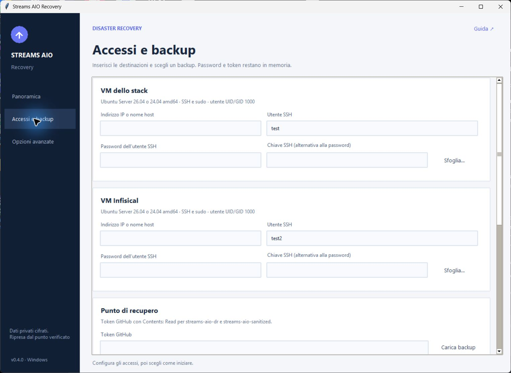
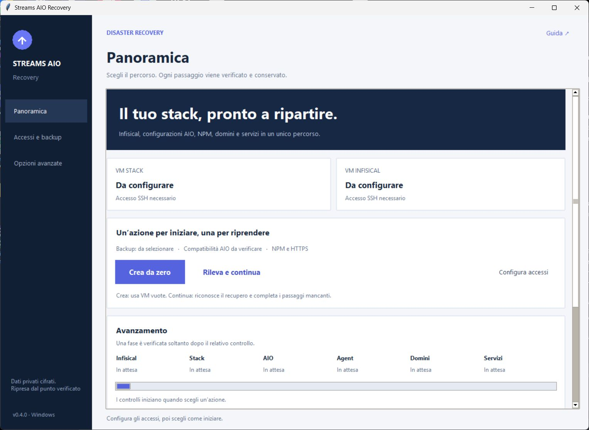

# Guida pratica · Streams AIO Recovery 0.4.17

Questa guida segue la dashboard: **Panoramica**, **Accessi e backup**, **Opzioni avanzate**. Il percorso recupera due VM e importa automaticamente i database AIO da un backup completo. Il [README](../README.md#stato-delle-verifiche) distingue i controlli già eseguiti dalle prove applicative ancora da completare.

## 1. Preparare le due VM

Usa **Ubuntu Server 26.04 o 24.04 amd64**, seleziona OpenSSH durante l’installazione e crea un primo utente con sudo. L’utente SSH deve avere UID/GID 1000. Il nome può essere diverso per le due VM; non deve necessariamente essere `test` o `test2`. [Preparazione in Proxmox](PROXMOX.md).

La GUI installa Docker e le dipendenze. Non crea le VM in Proxmox e non installa Ubuntu. Fedora sull’Infisical originale non significa che Fedora sia supportata come nuova destinazione della GUI.

Esempio di destinazioni, da sostituire con quelle del proprio recupero:

| Ruolo | IP SSH | Utente della prova |
| --- | --- | --- |
| Stack | `192.168.178.20` | `test` |
| Infisical | `192.168.178.31` | `test2` |

Sono esempi della prova, non valori obbligatori del nuovo profilo operativo. Per **Crea da zero**, entrambe le VM devono essere vuote e distinte. Per un recupero già presente usa **Rileva e continua**.

### VM ricreata o indirizzo IP diverso

Per un recupero su VM nuove e vuote, inserisci in **Accessi e backup** gli IP o i nomi host attuali. Possono essere diversi da quelli originali e dagli esempi. L’indirizzo previsto per i domini resta un campo separato e deve corrispondere al loro instradamento effettivo.

Una reinstallazione cambia l’impronta SSH anche mantenendo lo stesso IP. Dalla **0.4.7**, quando una destinazione conosciuta presenta una chiave diversa, la GUI mostra **indirizzo e porta, impronta precedente e nuova impronta**. Prima di accettare, apri la console della nuova VM in Proxmox e visualizza le impronte delle sue chiavi pubbliche:

```bash
for key in /etc/ssh/ssh_host_*_key.pub; do
  ssh-keygen -lf "$key" -E sha256
done
```

La nuova impronta `SHA256:…` mostrata dalla GUI deve corrispondere a una di queste. Se corrisponde alla VM che intendi recuperare, accetta l’aggiornamento e continua. In caso contrario rifiuta e controlla indirizzo e console. Alla prima connessione a un nuovo indirizzo viene richiesta la stessa verifica della chiave presentata.

La GUI controlla la chiave approvata nella nuova connessione e la memorizza solo dopo l’autenticazione riuscita. Un rifiuto, un annullamento o una password errata conservano la chiave precedente. Viene aggiornata soltanto la destinazione selezionata, compresa la porta: le identità delle altre VM e il file SSH di sistema restano conservati. Non occorre cancellare `known_hosts` né disattivare i controlli SSH.

Questa procedura consente di collegare VM ricreate e iniziare un nuovo recupero. Cambiare l’IP di una VM già ripristinata richiede anche una migrazione dei collegamenti e del checkpoint: la sola accettazione della chiave SSH non effettua quella migrazione.

## 2. Preparare gli accessi e la chiave

Apri **Accessi e backup** e compila le due schede VM.



| Campo | Valore da inserire |
| --- | --- |
| Indirizzo IP o nome host | Indirizzo raggiungibile dal PC Windows. |
| Utente SSH | L’utente Ubuntu creato su quella VM. |
| Password dell’utente SSH | La password di quell’utente Ubuntu. |
| Chiave SSH | In alternativa alla password, il file della chiave privata SSH autorizzata sulla VM. |

La password SSH non è il token GitHub, la password di Infisical o il suo client secret. Se sudo usa la stessa password SSH, lascia vuoto il relativo campo nelle **Opzioni avanzate**. Compila lì le porte diverse da 22 e le eventuali passphrase delle chiavi SSH.

Per GitHub usa un token fine-grained con accesso a `dav1dera/streams-aio-dr` e `dav1dera/streams-aio-sanitized`, permesso **Contents: Read**. Non occorre un token con accesso in scrittura per recuperare.

Nel campo **File della chiave privata age PRIMARY o RECOVERY** premi **Sfoglia** e scegli il file della identity compatibile con il backup. Il file contiene la riga originale `AGE-SECRET-KEY-1…`; può avere estensione `.txt`. PRIMARY e RECOVERY sono alternative se entrambe sono destinatarie del backup scelto.

Le stringhe `age1…` sono chiavi pubbliche: non permettono di ricostruire la chiave privata. Non cambiare un prefisso per trasformarle in identity. Conserva copie offline delle chiavi private e non inserirle in repository, screenshot o messaggi.

## 3. Scegliere un backup completo

Premi **Carica backup**, poi seleziona **Backup pubblicato**. Il campo **Commit associato al backup** viene compilato leggendo il manifest della release: per il nuovo flusso non scegliere a mano il `main` più recente al posto del commit registrato.

Un punto adatto al recupero automatico deve contenere:

| File della release privata | Contenuto |
| --- | --- |
| `manifest.json` con schema 2 | Identificativo del punto, commit dello stack e inventario degli artifact. |
| `SHA256SUMS` | Checksum del manifest e degli artifact pubblicati. |
| `infisical-config.tar.gz.age` | Configurazione privata Infisical. |
| `infisical-postgres.dump.age` e `infisical-postgres-globals.sql.age` | Database e ruoli Infisical. |
| `infisical-agent-infisical-agent.tar.gz.age` | Configurazione e credenziali dell’Agent. |
| `npm-database.sqlite.age` | Configurazione NPM prevista dal flusso di recupero. |
| `aio-state.tar.gz.age` | Snapshot nativi dei due database AIO, immagini associate e verifiche delle chiavi di cifratura. |

Il programma verifica release pubblicata, inventario, checksum, commit, identity e contratto dei dati prima di usare il contenuto. La presenza della release nell’elenco non dimostra da sola che sia completa o compatibile.

I backup precedenti senza `aio-state.tar.gz.age` non diventano completi aggiornando l’eseguibile. Il percorso automatico richiede un nuovo backup schema 2 prodotto e verificato dall’originale. Dalla 0.4.9 la GUI non mostra più export JSON o payload AIO: il recupero usa i database nativi inclusi nel backup.

Il campo **File integrativo cifrato .age** compare nelle **Opzioni avanzate** soltanto se il recupero segnala un input mancante, per esempio la lista email OAuth. Resta disponibile per riprovare lo stesso punto di recupero; scegliendo un backup o un commit diverso viene nascosto e la selezione viene rimossa. Questo file non sostituisce lo snapshot AIO. Il campo della chiave privata age PRIMARY o RECOVERY resta sempre disponibile in **Accessi e backup**.

## 4. Scegliere la destinazione dei domini

Nella build locale 0.4.17 usa il riquadro **Domini e controller prima dell’avvio**, disponibile in Panoramica e in Accessi e backup. Scegli la modalità e l’IP atteso prima di iniziare. **Usa IP della VM stack (LAN)** copia l’indirizzo SSH; usalo soltanto quando i domini devono raggiungere direttamente quell’IP LAN. Il programma non modifica i record DNS.

**I DNS rewrite sono gestiti manualmente.** In AdGuard o nel DNS locale indirizza i domini dei servizi recuperati verso l’IP LAN della VM stack. Anche il dominio HTTPS Infisical deve raggiungere questo indirizzo: NPM sulla VM stack inoltra le richieste alla VM Infisical. Nel router inoltra le porte TCP **80 e 443** alla VM stack. La GUI non modifica AdGuard, il resolver di Ubuntu o gli inoltri del router.

Queste modifiche spostano il relativo traffico locale verso il recupero. Al termine di una prova, ripristina i record DNS e gli inoltri precedenti prima di tornare alle VM originali.

Quando Tailscale usa Headscale dello stack, il DNS viene controllato prima degli avvii applicativi. Headscale e NPM devono essere pronti prima della registrazione Tailscale. Una destinazione LAN precedente produce `TAILSCALE_CONTROLLER_DNS_MISMATCH`: correggi il record nel DNS che lo gestisce e riprendi con **Rileva e continua**, senza azzerare i database.

### Prova affiancata alle VM operative

Mantieni attive le VM originali e usa un instradamento DNS dedicato al test per portare i nomi del backup sulle nuove VM. DDNS, Watchtower e Deunhealth restano esclusi. Il recupero usa HTTPS e l’indirizzo CometNet reale: non ricrea il vecchio profilo locale della 0.3.17.

L’instradamento deve funzionare anche da Comet attraverso Gluetun/VPN, perché CometNet esegue lì il proprio controllo di raggiungibilità. Cambiare soltanto il file hosts di Windows non modifica la risoluzione dei contenitori. Un DNS dedicato visibile solo sulla LAN potrebbe non essere raggiungibile dalla VPN.

La prova affiancata può verificare HTTPS e la destinazione del recupero; la raggiungibilità P2P da Internet deve essere collaudata separatamente, perché i peer pubblici potrebbero raggiungere ancora la produzione.

### Recupero della produzione

Usala quando il traffico dei domini deve raggiungere le VM sostitutive. Prepara prima gli indirizzamenti DNS e il port forwarding del router verso NPM. La scelta abilita il completamento del recupero operativo e l’attivazione finale di Cloudflare DDNS, Watchtower e Deunhealth.

**La GUI non cambia DNS pubblici, router o port forwarding.** La scelta della modalità è esplicita, ma non effettua automaticamente il trasferimento del traffico. Per una simulazione con gli originali ancora operativi scegli la modalità affiancata.

### Indirizzo IP previsto per i domini

Inserisci l’IP previsto dall’instradamento dei domini, non necessariamente quello usato per SSH. In produzione può essere l’IP pubblico; in una prova può essere l’indirizzo della destinazione di test. Questo campo registra la destinazione scelta: non modifica il DNS e non sostituisce la prova effettiva del percorso HTTPS.

NPM deve già avere una route compatibile con l’upstream CometNet sul servizio Gluetun. Le route che puntano soltanto a un vecchio IP LAN richiedono una verifica e un adattamento esplicito: la preview non le riscrive indovinando la destinazione.

## 5. Avviare o riprendere

Torna alla **Panoramica**, controlla le due destinazioni e scegli:



| Azione | Quando usarla |
| --- | --- |
| **Crea da zero** | Le due VM sono nuove, senza dati o risorse del precedente stack. |
| **Rileva e continua** | Esiste un tentativo del recupero scelto oppure vuoi rilevare e completare il suo avvio. |

Entrambe le azioni controllano backup e identità delle VM prima di preparare il recupero. **Rileva e continua esegue anche i passi mancanti:** non è un pulsante di sola diagnostica.

La ripresa verifica macchina, backup, commit, file, proprietà di container e volumi e stato registrato. Non basta che un container abbia un nome simile. Un checkpoint incompatibile o un’operazione ancora registrata come incompleta ferma la procedura, conservando lo stato da esaminare.

**Crea da zero non cancella risorse esistenti.** Per un nuovo collaudo completo ripristina uno snapshot pulito o crea nuove VM di test. Il vecchio reset circoscritto alle `.29/.30` non fa parte delle due azioni operative della dashboard.

Tieni il PC collegato e non avviare un secondo recupero o script di modifica in parallelo. Se interrompi, lascia terminare l’operazione corrente, conserva gli esiti e usa **Rileva e continua** con le stesse scelte. Non cancellare file di stato per far sparire un errore.

## 6. Cosa succede durante il recupero

1. **Infisical** — installazione delle dipendenze, controllo del punto scelto, decifratura e recupero di configurazione, ruoli, database e API.
2. **Stack** — lettura dei secret, generazione dei file, directory e permessi; verifica della compatibilità del primo avvio con le immagini previste.
3. **AIO e NPM** — recupero del database NPM e ripristino nativo di AIOStreams e AIOMetadata.
4. **Agent** — installazione dell’Agent continuo e del tunnel SSH permanente tra le nuove VM.
5. **Avvio per dipendenze** — verifica delle immagini; OAuth2 Proxy viene avviato prima di NPM per rendere disponibile il servizio di autenticazione alle sue route. Headplane attende Headscale, NPM e il collegamento HTTPS verificato.
6. **NPM prima di CometNet** — riemissione TLS e preparazione della route, quindi prova della destinazione HTTPS dal percorso Gluetun/VPN. Solo dopo viene avviato CometNet con il proprio indirizzo WSS reale.
7. **Verifica finale** — controllo degli upstream NPM e dei servizi. In produzione i tre controller pubblici vengono attivati per ultimi.

L’ordine OAuth2 Proxy → NPM → Headplane/Tailscale/CometNet evita il blocco Nginx causato dal proxy di autenticazione ancora assente. La correzione riguarda il piano di avvio: Compose, autenticazione e controlli TLS restano conservati. Una risposta temporanea univoca inserita nella route NPM deve tornare dal nuovo server: il certificato valido del server originale non è sufficiente. La risposta viene poi rimossa e la configurazione NPM ripristinata.

I controlli applicativi automatici registrano l’infrastruttura e l’avvio. Non possono confermare da soli che ogni login, configurazione addon o autorizzazione esterna funzioni: servono le prove sotto.

## Dati conservati e dati ricostruibili

Gli snapshot AIO copiano i database SQLite nativi con la loro struttura, senza convertire un export JSON a una versione diversa. Conservano gli UUID, gli hash delle password, i profili e i record OAuth già presenti. Prima del ripristino vengono confrontati immagini applicative e collegamento alle chiavi di cifratura recuperate da Infisical.

Questo evita di creare nuove identità al posto di quelle originali. Non prolunga però la validità di un token già revocato o scaduto presso un servizio esterno: AniList, Trakt e gli altri collegamenti devono essere provati dopo il recupero.

| Dato | Trattamento |
| --- | --- |
| Infisical, chiavi applicative e credenziali Agent | Recuperati dagli artifact cifrati del punto scelto. |
| NPM, route e impostazioni TLS previste | Recuperati; certificati riemessi dal flusso previsto e HTTPS verificato. |
| Database SQLite AIOStreams e AIOMetadata | Recuperati automaticamente dalla capsule AIO coerente. |
| Configurazioni e credenziali Comet/StremThru | Ricostruite dai secret e dai template previsti. |
| Database e cache ricostruibili già esclusi, inclusi Comet, CometNet, StremThru e Redis | Ripartono vuoti; scraping e cache si ricostruiscono. |
| Cache AIO, Jackett e DNSCrypt dichiarate ricostruibili | Non incluse nella capsule AIO. |
| Stati opzionali di altri servizi, account locali e registrazioni dei nodi | Da riconciliare nell’inventario e verificare nelle applicazioni prima di dichiarare equivalenza alla produzione. |

Il recupero non svuota indiscriminatamente PostgreSQL condiviso o volumi sconosciuti. La compatibilità del primo avvio resta legata ai layout e ai digest verificati: un aggiornamento delle immagini può richiedere un nuovo controllo del profilo.

## Se compare un errore

Premi **Salva esiti** e conserva il registro. Risolvi la causa indicata, poi riprendi con gli stessi accessi, backup e destinazioni. I messaggi generici di arresto descrivono l’esito; il codice specifico del passo identifica il controllo che non è passato.

| Messaggio o situazione | Cosa controllare |
| --- | --- |
| `SSH_AUTH_FAILED` | Utente Ubuntu, password o chiave della VM corretta. |
| `SSH_CONNECTION_FAILED` | VM accesa, IP, porta SSH e raggiungibilità dal PC. |
| `SSH_HOST_KEY_CHANGED` | Verifica indirizzo e nuova impronta dalla console della VM. La 0.4.7 propone l’aggiornamento della sola destinazione; se la chiave cambia ancora durante il collegamento, il recupero si ferma. [Procedura](#vm-ricreata-o-indirizzo-ip-diverso). |
| `SSH_HOST_KEY_STORE_FAILED` | La GUI non riesce a salvare l’identità verificata nella cartella locale `StreamsAIORecovery`. Controlla i permessi della cartella e riprova. |
| `GITHUB_REPOSITORY_OR_RELEASE_UNAVAILABLE` | Token, repository selezionati e permesso Contents: Read. |
| `AGE_PUBLIC_KEY_NOT_IDENTITY` | È stato scelto un file pubblico `age1…`; occorre l’identity privata originale. |
| `AGE_NO_MATCHING_RECIPIENT` | Identity e release non appartengono allo stesso backup; scegli una PRIMARY/RECOVERY compatibile. |
| Backup AIO richiesto | Scegli un nuovo punto schema 2 con `aio-state.tar.gz.age`; la vecchia release non contiene lo snapshot nativo. |
| Collegamenti NPM assenti dal backup | Scegli un nuovo punto completo con la topologia NPM cifrata. Una vecchia copia non contiene la prova necessaria per adattare gli upstream alle due nuove VM. |
| Ricevuta AIO o NPM incompatibile | Conserva database, checkpoint ed esiti. La ripresa automatica richiede ricevute e copie corrispondenti; non eliminarle per forzare il passaggio. |
| Lista email OAuth assente | Completa l’input nell’Infisical originale e crea un nuovo backup. I vecchi tentativi possono usare un companion cifrato compatibile nelle Opzioni avanzate. |
| Commit del backup non coerente | Ricarica il punto scelto e usa il commit registrato nel suo manifest. |
| VM non vuota o risorse non riconosciute | Usa Rileva e continua per il tentativo compatibile; per un test nuovo usa VM pulite. |
| Checkpoint incompatibile o operazione incompleta | Conserva lo stato e il registro; non eliminare il checkpoint e non riavviare un reset alla cieca. |
| Errore dei domini, HTTPS o CometNet | DNS dal percorso VPN, destinazione del router, route/upstream NPM, certificato e WebSocket. |
| Immagine o layout non supportato | Confronta il punto di recupero con la versione della GUI e il profilo verificato. |

## Backup giornaliero

Il timer sull’host originale è stato installato e verificato il 9 ottobre 2026: **ogni giorno alle 04:30 nel fuso della VM**, con ritardo casuale fino a 10 minuti e recupero delle esecuzioni perse. Il deployment usa **Europe/Rome**. La retention mantiene cinque release verificate; esecuzioni manuali aggiuntive usano gli stessi cinque punti.

La release completa `dr-20261009T194149Z` ha superato inventario, SHA256 e decifratura di tutti i sei artifact con PRIMARY e RECOVERY; è stata usata nel recupero 0.4.5. La frequenza del timer, da sola, non prova il successo delle esecuzioni successive.

Ogni cattura comprende snapshot SQLite nativi AIOStreams/AIOMetadata, NPM, Agent e database/configurazione Infisical. Il coordinatore sincronizza prima la parte pubblica e registra il suo commit verificato. Una modifica live non cambia una release esistente: entra nel successivo backup riuscito. Dopo modifiche importanti all’Agent, ai secret o ai profili puoi anticiparlo con `sudo systemctl start streams-aio-dr.service` sull’host coordinatore.

Questa GUI non installa automaticamente il coordinatore sul nuovo host. Per la continuità dei backup dopo un trasferimento definitivo segui il [README DR](https://github.com/dav1dera/streams-aio-dr#install-on-docker-stack): producer, timer, destinatari age pubblici, accessi SSH e GitHub di scrittura.

Controlla periodicamente:

- timer attivo/abilitato, calendario e fuso corretti;
- esito dell’ultima esecuzione e data dell’ultima release pubblicata verificata;
- schema 2, inventario/checksum completi e commit pubblico coerente;
- una prova di decifratura e recupero con le identity private custodite fuori dal PC.

Le unità attuali non inviano notifiche di errore. Una nuova app richiede anche una scelta esplicita per il suo stato: aggiungerla al Compose non include automaticamente il suo database nel backup.

## Collaudo finale

Per dichiarare il risultato equivalente allo stack originale devono essere completate e registrate tutte queste prove. I test locali della preview e la prova storica 0.3.17 non le sostituiscono.

- [x] Produrre sull’originale un backup completo schema 2 e verificarlo con entrambe le identity private (`dr-20261009T194149Z`).
- [x] Completare il recupero applicativo con la 0.4.17 da due VM svuotate di container, volumi, database, configurazioni e checkpoint; Docker e cache immagini erano già presenti.
- [ ] Ripetere il percorso da Ubuntu appena installato senza Docker e senza cache immagini.
- [ ] Interrompere in un punto controllato e completare con **Rileva e continua**, conservando dati e identità.
- [x] Verificare Agent/tunnel e controlli automatici dei servizi (report 0.4.5 del 10 ottobre 2026).
- [ ] Accedere a Infisical e NPM; verificare route, certificati e domini sulla nuova destinazione.
- [ ] Accedere ad AIOStreams e AIOMetadata con le identità originali; confrontare profili, configurazioni e URL addon.
- [ ] Provare AniList, Trakt, provider e gestori esterni; registrare soltanto le riautorizzazioni realmente necessarie.
- [ ] Provare OAuth2 Proxy e la lista email consentite.
- [ ] Verificare CometNet WSS attraverso NPM e un collegamento P2P da un percorso esterno.
- [ ] Verificare che i database/cache esclusi si inizializzino e riprendano scraping o ricostruzione.
- [ ] Riconciliare gli stati opzionali con l’inventario dell’originale.
- [x] Completare il controllo automatico dei tre controller in modalità produzione (report 0.4.5). La disponibilità pubblica completa resta soggetta alle prove esterne.
- [ ] Riavviare entrambe le VM e ripetere le prove di accesso, Agent, HTTPS e servizi.
- [x] Confermare il timer giornaliero sull’originale (9 ottobre 2026).
- [x] Confermare pubblicazione completa e decifratura del punto usato nel recupero 0.4.5.

Il **14 ottobre 2026**, la **0.4.17** ha completato il recupero applicativo da due VM svuotate, usando `dr-20261013T023710Z`. Docker e cache immagini erano già presenti. Sono passati Infisical, AIO, Agent, Headplane/Headscale, Tailscale, NPM, HTTPS, CometNet, controller e controlli finali. Un upstream esterno è rimasto non raggiungibile. L'utente ha confermato i due addon AIO funzionanti in Stremio dal telefono; sul PC è stata rilevata una differenza DNS. P2P pubblico, tutte le integrazioni e persistenza dopo riavvio restano da verificare. [Stato aggiornato](../README.md#stato-delle-verifiche).

## Trasferimento sulle VM appena installate

Dalla 0.4.8 il programma crea anche le directory intermedie private con il
proprietario dell’utente SSH. Riconosce e corregge la struttura root-only
lasciata dal vecchio uploader dopo `OPERATION_STOPPED`, senza eliminare il
tentativo. Premi **Rileva e continua** con gli stessi accessi e backup.
`SSH_UPLOAD_PATH_REFUSED` indica una struttura diversa da quella riparabile;
`SSH_UPLOAD_FAILED` indica un errore nel trasferimento SSH/SFTP. Il registro
mostra se il trasferimento riguarda Infisical oppure lo stack.
